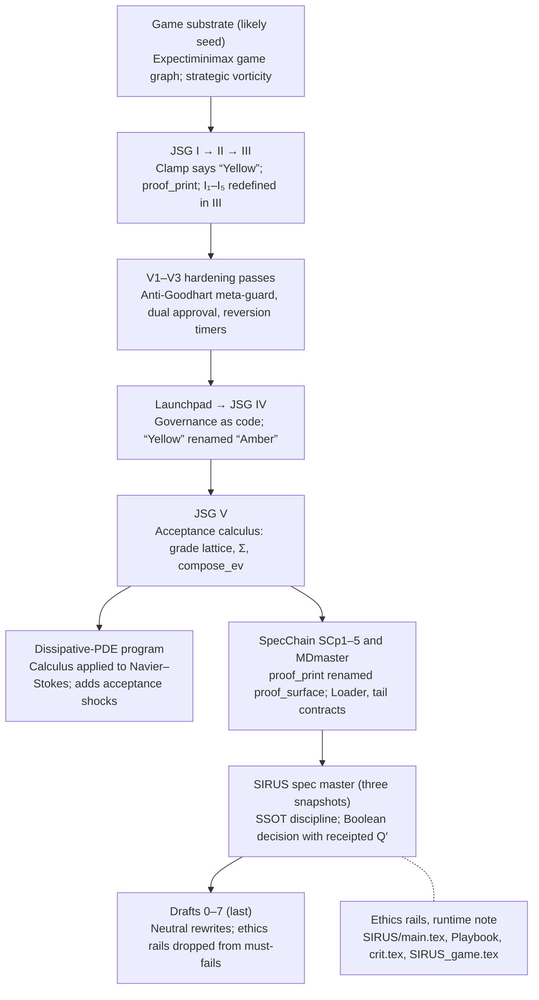

# JSG / SIRUS Master Guide (Skeleton)

Sep 29, 2026 · @Marley McWilliams

## Purpose and reading rules

This guide is the single canon for JSG I–V, SpecChain, the SIRUS spec, the Navier–Stokes program, and the drafts. Every component carries a tag that says what can justify it.

1. **One home per concept.** Each term is defined once, in the glossary. Other documents link to it and never restate it.
2. **Every component names its justification:** provable in Lean now, provable with analysis, checked per certificate, tested in CI, open mathematics, or a declared value (see the layer map).
3. **Conformance is not correctness.** CI shows the work conforms to the spec. Lean shows the spec's internal lemmas hold. Neither shows that a threshold, a model, or a value is right; that stays a signed human decision.
4. **Retired terms stay as aliases.** Old documents keep reading correctly, and new text uses only canonical terms.

## Corpus lineage

The JSG books came first and the neutral drafts last. The order is inferred from renamed terms, because the dates embedded in the files are partly example values.



*corpus lineage · 8 stages, 2 side branches*

Solid arrows mean a stage builds on the one before it; the dashed line marks work from the same period. The PDE program branches off the JSG V calculus.

## Canonical glossary

Twenty-two terms, each with one home. The SIRUS name waits: not yet, since no v1 statement depends on it.

| Canonical term | Meaning | Replaces or aliases | Home |
| --- | --- | --- | --- |
| Graded values **G** | Per-axis intervals \[lo, hi\] in \[0, ∞\]; the verdict reads hi; ordered by badness (endpoints) and by information (narrower is better) | "Q" in JSG V, the PDE paper and SCp2 | Core v2 |
| Floor axes **M** | Per-window rates; combined by max | max-channels, Q\_max | Core v2 |
| Budget axes **S** | Cumulative spends; combined by +; each carries a subadditivity side condition | sum-channels, Q\_sum, ledger and CVaR axes | Core v2 |
| Unknown | The interval \[0, ∞\]; a lease β allows width up to β, and anything wider is a breach | ⊤unk (JSG V, PDE); ⊥ in SCp1 and SCp2, placed below every value (a known defect); "third value" (SIRUS spec) | Core v2; PDE I4b |
| Combine **⊕** | Endpointwise max on M, + on S; a commutative monoid, not a join (on S, g ⊕ g = 2g) | "Parallel join"; horizontal ⊙ (JSG V); ∧ (PDE; SCp1, Def 2.2); ⊎ and ⊙ (SCp2) | Core v2 |
| Sequential composition | Resolved: the same ⊕; sequence and parallel differ only in data flow | vertical ∧ (JSG V); ∧ (SCp1, Prop 7.4, where it is ⊕); ⋆ (SCp2, whose "∧ ≡ ⋆" misreads SCp1) | Core v2 |
| Residual **θ ⊸ g** | Budget left for later stages: θ ⊖ g on S; θ on M when g ≤ θ | None | Core v2 |
| Decision **D** | {REJECT < ACCEPT}; no third value | "Q" in the SIRUS spec | SIRUS spec §1.2 |
| Verdict map **δ\_θ** | Indicator of the down-set of θ, read on upper endpoints | Implicit threshold checks | Core v2 |
| Receipted result **R** | (grade, receipt address, metrics). The decision is derived as δ\_θ(grade), never stored, and metrics cannot influence the grade | Q′ | SIRUS spec §1.4 |
| Obligations **Σ** | Typed: each has a witness type and an authority stage; progress is the Dershowitz–Manna order | Typed effects | Core v2 |
| Must-pass set **MP** | Inputs the gate must ACCEPT; disjoint from the must-fail set | None | Core v2 |
| Frontier charge **Δ\_fr** | Total variation A · Σ‖jump\_k‖ at the finest resolution; additive, so regrouping can't change it | C\_fr, frontier spend, C\_salt, the subadditive merged-crossing debit | Core v2 |
| **proof\_surface** | Window or run digest binding the guard IDs in fixed order | proof\_print, proof print | SCp1 |
| Guard order | EF → DRO → PR → CBF → ω | None | JSG III |
| **ω stage** | Automata verdict over KPI row hashes; the fifth guard | "Ω" in the SIRUS pipeline | JSG III |
| Uncertainty set **𝒰** | Model-uncertainty set for PR/GKYP witnesses and degraded profiles | "Ω" in JSG II–IV, including Ω\_wc | JSG IV §Ω contract |
| Clamp states | Green, Amber, Red | "Yellow" | JSG IV |
| Invariant families | Prefix by family: H1–H5 (governor, JSG III list), A1–A5 (PDE acceptance), L1–L10 (Loader), T11–T13 (tail contracts) | I₁–I₅ (three incompatible versions); I1–I13 | New |
| Policy lattice **⪰** | Dials in a complete lattice, larger is stricter; E(t) = baseline ⊓ active weakenings; threshold dials store their inverse | "Strictest unexpired policy P\*"; ThresholdChange VC semantics | Core v2 |
| **SIRUS** (this project) | The governance and evidence spec | Also the name of Bénard et al.'s random-forest rule-set algorithm; the two were merged in MDmaster | Not yet: no v1 statement depends on it |
| Content address | BLAKE3-256 of canonical bytes | `b3:…` placeholders (849 in the master spec) | SIRUS spec §0.5 |

## Layer map

Twelve components can be proved in Lean now and four more with analysis; a fifth, the Jacobi frontier defect, is out of scope until it's well-posed. The other eight are checked per instance, tested, open, or declared. Layers sort components by what justifies them, not by what enforces them: a Norm row is a declared value, and whether a gate also enforces it is a separate question. In v1 no gate enforces the Norm rows ([decisions/RAILS.md](decisions/RAILS.md)). Every row has a status and a pointer. A Proved row names its Lean theorems and its limits, and points to the proof file and the milestone note that explains each proof. Every other row says why it is out of scope, or not in v1, and points to that reason: the CI layer, a certificate, open math or the Norm layer.

| Component | Layer | Status | Pointer | Source |
| --- | --- | --- | --- | --- |
| Graded values: combine laws, interchange equation, residual threading | Lean now | Proved (`combine_comm`, `combine_assoc`, `interchange`); residual threading for one budget axis, through any number of stages, an overspent one included (`residual_spec`, `threads_spec`) | [Milestone1.lean](../lean/JSG/Proofs/Milestone1.lean), [Milestone2.lean](../lean/JSG/Proofs/Milestone2.lean) (`threads_spec`), [MILESTONE_1.md](MILESTONE_1.md) | JSG V §2 |
| Receipt integrity: replaying the addressed content yields the grade | Lean now | Not in v1: deferred to the version that first needs it. What would make it true, collision resistance and replay determinism, belongs to the CI layer; the concrete Loader's L10 already binds the receipt bundle to its recorded root | [QUEUE.md](QUEUE.md), Q6 | SIRUS spec §0.5; JSG V §6 |
| Verdict: an axis over its threshold rejects, unknowns included; complete evidence within θ accepts | Lean now | Proved (`verdict_sound`, `verdict_complete`) | [Milestone1.lean](../lean/JSG/Proofs/Milestone1.lean), [MILESTONE_1.md](MILESTONE_1.md) | SIRUS spec §1.2–1.3 |
| Noninterference: metrics cannot change the grade | Lean now | Proved for noninterfering graders (`no_flip`); no real grader shown noninterfering yet | [Milestone1.lean](../lean/JSG/Proofs/Milestone1.lean), [MILESTONE_1.md](MILESTONE_1.md) | SIRUS spec §1.4 |
| Loader: invariant preserved; Dershowitz–Manna progress | Lean now | Proved for any Loader (`Loader.safe`, `Loader.terminates`) and for a concrete one whose invariant is L1–L10 (`LoaderStep.inv_step`, `LoaderStep.progress`), built as a `Loader` in `Tests/ConcreteLoader.lean`; generic in its cryptographic primitives | [Milestone2.lean](../lean/JSG/Proofs/Milestone2.lean), [ConcreteLoader.lean](../lean/JSG/Tests/ConcreteLoader.lean), [MILESTONE_2.md](MILESTONE_2.md) | MDmaster SCp3; JSG V §3 |
| Frontier charge: additive under regrouping; chattering never free | Lean now | Proved (`charge_append`, `charge_chatter`) | [Milestone2.lean](../lean/JSG/Proofs/Milestone2.lean), [MILESTONE_2.md](MILESTONE_2.md) | PDE §10; MDmaster SCp2 |
| Policy lattice: expiry tightens; bridge to acceptance | Lean now | Proved (`expiry_tightens`, by Marley; `bridge`) | [Milestone2.lean](../lean/JSG/Proofs/Milestone2.lean), [MILESTONE_2.md](MILESTONE_2.md) | JSG IV, Governance as Code |
| Calibration: must-pass accepted, must-fail rejected, sets disjoint | Lean now | Proved for the test sets in `Calibration.lean` (`verdict_calibrated`) | [Calibration.lean](../lean/JSG/Tests/Calibration.lean), [MILESTONE_1.md](MILESTONE_1.md) | Core v2; Operational Playbook (must-fail coverage) |
| Capped governance fold: bounded, with a vacuous nightly check | Lean now | Proved (`fold_check_vacuous`) | [Milestone1.lean](../lean/JSG/Proofs/Milestone1.lean), [MILESTONE_1.md](MILESTONE_1.md) | JSG IV aggregator lemma |
| Must-fail CI gate: accepted histories keep every unsigned failure class | Lean now | Proved for the gate's rule (`mfGate_signed`); CI doesn't yet run the gate on real histories | [Milestone2.lean](../lean/JSG/Proofs/Milestone2.lean), [MILESTONE_2.md](MILESTONE_2.md) | Draft0–7 |
| Typed obligations (authority and witness); unknowns lease as interval width ≤ β | Lean now | Proved (`pass_sound`, `pass_complete`, `lease_sound`, `lease_complete`) | [Milestone2.lean](../lean/JSG/Proofs/Milestone2.lean), [MILESTONE_2.md](MILESTONE_2.md) | JSG V §3; PDE §2.2, I4b |
| Executable twins: graded values, combine, verdict, residual threading, widths and leases, computed exactly | Lean now | Stub: eight agreement theorems in the `statements-v4` draft ([QUEUE.md](QUEUE.md), Q11 and Q15) | [EXECUTABLE_GATE.md](EXECUTABLE_GATE.md) §1 | Core v2; SIRUS spec §1.4, whose Q′ must commute with its projection π |
| CVaR tail-to-level step (C₀ = 1) | Lean + analysis | Proved (`cvar_tail_to_level`), for any measure and tail mass. This is the tail-to-level step only; Lemma 9.1's rescaling to the CKN threshold and its Vitali overlap count aren't stated | [Milestone3.lean](../lean/JSG/Proofs/Milestone3.lean), [MILESTONE_3.md](MILESTONE_3.md) | PDE Lemma 9.1 |
| No-Zeno dwell bound, corrected | Lean + analysis | Proved (`dwell_lower_bound`, by Marley), with the speed bound S\_max in place of JSG I's α | [Milestone3.lean](../lean/JSG/Proofs/Milestone3.lean), [MILESTONE_3.md](MILESTONE_3.md) | JSG I Lemma 1 |
| Local KL–Fisher quadratic bound | Lean + analysis | Proved (`kl_fisher_local`) in whitened coordinates, for every ε ≤ 1. Read in raw coordinates, as jsg-lab computes its radius, the bound fails | [Milestone3.lean](../lean/JSG/Proofs/Milestone3.lean), [MILESTONE_3.md](MILESTONE_3.md), [KLFisher.lean](../lean/JSG/Lemmas/KLFisher.lean) | JSG I FIM bound |
| DRO envelope identity dv/dρ = η\* | Lean + analysis | Proved (`dro_envelope`) for the dual value, given a minimizing multiplier that moves continuously. Strong duality, that the dual is the worst-case risk, isn't stated | [Milestone3.lean](../lean/JSG/Proofs/Milestone3.lean), [MILESTONE_3.md](MILESTONE_3.md) | JSG II ρ-sensitivity |
| Geometry-scaled Jacobi frontier defect | Lean + analysis | Out of scope: its defect Δ\_fr is never defined, and its bound adds ‖S‖∞ to ‖∇S‖∞, which have different units ([QUEUE.md](QUEUE.md), Q8) | [QUEUE.md](QUEUE.md), Q8 | JSG I Lemma 3 |
| PR/GKYP witnesses | Certificate | Out of scope: certificate layer. A witness is checked for each instance, not proved once; checking witnesses as exact rationals in Lean is a Phase 6 option | [ROADMAP.md](ROADMAP.md#phase-6-guide-v1-then-choose), the Certificates option; [IDEAS.md](IDEAS.md#certificates) | JSG II–IV |
| CBF tube residuals and saltation replay | Certificate | Out of scope: certificate layer, replayed for each instance | [ROADMAP.md](ROADMAP.md#phase-6-guide-v1-then-choose), the Certificates option | JSG III |
| Statistical gates: HAC and bootstrap CIs, BY FDR, SPRT, MTC; interval enclosure (lo ≤ truth ≤ hi) at a declared coverage | CI / test | Out of scope: CI layer. Coverage is empirical, so interval enclosure holds at a declared level, which a test checks and Lean can't | [Positive controls](#unified-core-objects-v2), in the core objects | JSG II |
| Determinism envelope and proof\_surface replay | CI / test | Out of scope: CI layer, checked by replaying runs byte for byte | [QUEUE.md](QUEUE.md), Q6 | SIRUS spec §12; JSG IV |
| ACT→JSG compiler soundness and completeness | Open math | Out of scope for v1: open math. Its adequacy theorem isn't stated precisely yet; stating and freezing it is a Phase 6 option | [ROADMAP.md](ROADMAP.md#phase-6-guide-v1-then-choose), the compiler option | JSG IV Launchpad |
| Navier–Stokes regularity spine L1–L5 | Open math | Out of scope: open math. Its L4 assumes a finite ledger sum, which is where the difficulty lies, so nothing else may depend on it | [Known defects](#known-defects-and-proposed-fixes), "Navier–Stokes L4 is conditional" | DissipativePDEs |
| Golden Rule, restoration debt, consent brake, bravery-as-accountability | Norm | Out of scope: Norm layer. The four rails are declared values that no v1 gate enforces | [decisions/RAILS.md](decisions/RAILS.md) | SIRUS/main.tex |
| Alignment budgets and override taxonomy | Norm | Out of scope: Norm layer, declared values that no v1 gate enforces | [Layer map](#layer-map), its opening paragraph | JSG I appendix |

## Unified core objects (v2)

Four objects carry the calculus. This revision folds in an outside review of v1, which found that its seven objects were partly the same object in different notation, and that a gate rejecting everything satisfied every v1 theorem.

**1. Graded values.** Each axis holds an interval \[lo, hi\] in \[0, ∞\], and the verdict reads hi. A known value is \[x, x\], full ignorance is \[0, ∞\], and a lease β allows \[x, x + β\]. Floor axes M carry per-window rates and combine by max; budget axes S carry cumulative spends and combine by +. Both are commutative ordered monoids, so the operation is called **combine**, not join: on budgets, g ⊕ g = 2g.

```latex
[a,b] \oplus [c,d] = \begin{cases} [\max(a,c),\ \max(b,d)] & \text{floor axis} \\ [a+c,\ b+d] & \text{budget axis} \end{cases}
```

Sequential and parallel composition use the same ⊕. A stage is a function X → G × Y; stages in sequence pass Y along and combine their grades, so the two kinds of composition differ only in data flow, and interchange holds as an equation. Each budget axis registers a soundness side condition: the real quantity must be subadditive under composition, as CVaR is.

**2. Residuated budgets.** The verdict is the indicator of the down-set of θ, read on upper endpoints. On budget axes, accepted parts do not combine into an accepted whole, so each stage is checked against the residual that earlier stages left:

```latex
\theta \multimap g = \max\{h : g \oplus h \le \theta\} = \begin{cases} \theta & \text{floor axis, when } g \le \theta \\ \theta \ominus g \ \text{(truncated subtraction)} & \text{budget axis} \end{cases}
```

The same mechanism covers thresholds, the frontier charge, the governance cap and any explicit step bound. The frontier charge is total variation: A · Σ‖jump\_k‖ at the finest resolution. It is additive under concatenation, so no regrouping can change it, and chattering across a frontier and back is never free. A is computed conservatively, with ν̂\_min as a lower confidence bound and κ\_max, r\_tube as upper bounds, in ENNReal so that ν̂\_min = 0 gives A = ∞.

**3. Typed obligations.** Each obligation o has a witness type W(o) and an authority stage. Discharging o requires a witness of type W(o) produced at authority(o), and a window passes only when every emitted obligation was discharged that way. The Loader's progress is measured by the Dershowitz–Manna order on its pending obligations, which allows one obligation to be replaced by finitely many smaller ones. Its safety is a separate theorem: an invariant Inv (L1–L10) preserved by every accepted step. A halt with rejection carries the remaining obligations and the axes still unknown as its certificate.

**4. Policy lattice.** A policy maps dials into a complete lattice where larger is stricter. Must-fail classes are hard floors, not runtime dials: runtime weakenings can't touch them, and removing one takes a new statements version with a CHANGELOG line marking the weakening ([decisions/RAILS.md](decisions/RAILS.md)). The effective policy is a monotone baseline met with the active weakenings:

```latex
E(t) = B(t) \wedge \bigwedge \{\, w : w \text{ active at } t \,\}
```

Expiry removes a term from the meet, so it can only make E stricter. Thresholds are looser when larger, so a threshold dial stores its inverse (`threshold` in the stubs), and the bridge theorem catches the mistake if it doesn't: if P₂ ⪰ P₁ then Accept(P₂) ⊆ Accept(P₁). Weakenings are priced by magnitude × duration against a token bucket: a reservoir of capacity C that refills at rate ρ per window, both of them dials. Without the refill this is the lifetime budget again, just draining more slowly. The bucket bounds the rate of weakening, not its persistence: a weakening that costs at most ρ per window can be renewed forever, so three options are open: set ρ to the standing weakening you accept, cap each weakening's cumulative duration, or raise each consecutive renewal's cost by a factor γ > 1, which any finite C and ρ eventually refuse. Choosing among them waits for the milestone that states the token bucket, since no v1 statement depends on it. Escalation must be keyed to the dial being weakened, not to the request, or relabeling and brief lapses would reset it. It also needs a deliberate reset, such as decay after a quiet period, or one long episode leaves the dial effectively frozen.

**Positive controls.** Every property above is a safety property, and a gate that rejects everything satisfies all of them. Two counterweights are required: a must-pass set MP of inputs that must ACCEPT, kept disjoint from the must-fail set, and a completeness lemma: complete evidence whose values are within θ is accepted. That lemma stays nearly definitional unless a statement ties each interval to the true value (lo ≤ truth ≤ hi). That enclosure is empirical, because truth is measured: it holds at a declared coverage level and belongs to the CI layer, or to the certificate layer when the interval comes from exact computation on a model. It is not a Lean item. The real guard against vacuity is the must-pass set together with the always-reject mutant.

## Lean 4 statement stubs (v2)

Since Phase 2 the canonical text is `lean/JSG/Defs.lean` (definitions) and `lean/JSG/Statements.lean` (theorems), which compile against Mathlib v4.34.1; this sketch is kept in step with them for reading. Every theorem carries a `Mutant:` comment naming a plausible wrong implementation that fails it; a theorem without one doesn't earn its place. `lean/JSG/Tests/Mutants.lean` proves each mutant's counterexample and a witness instance. Confirm every Mathlib name with Loogle before relying on it.

```lean
import Mathlib

namespace JSG

/-! ## 1. Graded values -/

/-- Floors carry per-window rates (combine by max);
    budgets carry cumulative spends (combine by +). -/
inductive Kind | floor | budget

/-- An axis value is an interval in [0, ∞]; the verdict reads `hi`. -/
@[ext] structure Bound where
  lo : ENNReal
  hi : ENNReal
  le : lo ≤ hi

def Bound.known (x : ENNReal) : Bound := ⟨x, x, le_rfl⟩
def Bound.unknown : Bound := ⟨0, ⊤, le_top⟩

def combineAxis : Kind → Bound → Bound → Bound
  | .floor,  a, b => ⟨max a.lo b.lo, max a.hi b.hi, max_le_max a.le b.le⟩
  | .budget, a, b => ⟨a.lo + b.lo, a.hi + b.hi, add_le_add a.le b.le⟩

variable {ι : Type} (kind : ι → Kind)

abbrev Grade (ι : Type) := ι → Bound

def combine (g h : Grade ι) : Grade ι := fun i => combineAxis (kind i) (g i) (h i)

/-- Combining two grades gives the same grade in either order, whatever kind each
    axis has. -/
theorem combine_comm (g h : Grade ι) : combine kind g h = combine kind h g := by sorry
-- Mutant: overwrite, where the later stage's grade replaces the earlier one.

/-- How three grades are grouped doesn't change their combination, whatever kind
    each axis has. -/
theorem combine_assoc (g h k : Grade ι) :
    combine kind (combine kind g h) k = combine kind g (combine kind h k) := by sorry
-- Mutant: averaging budgets, (a + b) / 2, is commutative but not associative.

/-- Sequential composition. Core v2 makes it `combine`; naming it separately lets
    JSG V's rule be stated as a mutant of `interchange` (QUEUE.md, Q1). -/
def seqComp (g h : Grade ι) : Grade ι := combine kind g h

/-- Parallel composition, also `combine` in core v2. -/
def parComp (g h : Grade ι) : Grade ι := combine kind g h

/-- Interchange for a pair of composition operators: two pipelines run side by side
    grade the same as their stages run side by side, one stage after another. -/
def Interchange (seq par : Grade ι → Grade ι → Grade ι) : Prop :=
  ∀ a b c d, par (seq a b) (seq c d) = seq (par a c) (par b d)

/-- Sequential and parallel composition agree: interchange is an equation. -/
theorem interchange : Interchange (seqComp kind) (parComp kind) := by sorry
-- Mutant: JSG V's rule (max on every axis in sequence, + on budgets in parallel).

/-! ## 2. Verdicts and residuals -/

inductive Decision | reject | accept
  deriving DecidableEq

/-- Accept iff every upper bound is within its threshold. -/
noncomputable def verdict (θ : ι → ENNReal) (g : Grade ι) : Decision := by
  classical
  exact if ∀ i, (g i).hi ≤ θ i then .accept else .reject

/-- Soundness: an axis whose upper bound exceeds its threshold rejects the whole
    grade. An unknown, [0, ∞], rejects whenever its threshold is finite, and so does
    anything it combines into, such as [5, ∞]. -/
theorem verdict_sound (θ : ι → ENNReal) (g : Grade ι) (i : ι)
    (hover : θ i < (g i).hi) : verdict θ g = .reject := by sorry
-- Mutant: a verdict that reads `lo` instead of `hi` accepts unknowns. A bare threshold
-- check under SCp1's order does the same, since that order puts ⊥ below every value
-- (a known defect in the master guide). A gate that rejects only unknowns fails it
-- too: it accepts [2, 2] under θ = 1.

/-- Completeness: complete evidence within θ is accepted. -/
theorem verdict_complete (θ : ι → ENNReal) (g : Grade ι)
    (hk : ∀ i, (g i).lo = (g i).hi) (hin : ∀ i, (g i).lo ≤ θ i) :
    verdict θ g = .accept := by sorry
-- Mutant: the always-REJECT gate, which satisfies every safety theorem here.

/-- Budget left for later stages; ENNReal subtraction truncates at 0. -/
def residual (θ x : ENNReal) : ENNReal := θ - x

/-- When θ is finite and stage one fits within it, checking stage two against the
    residual it leaves is the same as checking the total. -/
theorem residual_spec (θ x y : ENNReal) (hθ : θ ≠ ⊤) (hx : x ≤ θ) :
    y ≤ residual θ x ↔ x + y ≤ θ := by sorry
-- Mutant: checking each stage against the full θ accepts x = y = θ.

/-- Raw evidence plus free-form metrics such as confidence scores. -/
structure Evidence (E : Type) where
  record  : E
  metrics : List (String × Float)

/-- No confidence inflation, stated where it can fail: an obligation on every grader. -/
def Noninterfering {E : Type} (gradeOf : Evidence E → Grade ι) : Prop :=
  ∀ r m m', gradeOf ⟨r, m⟩ = gradeOf ⟨r, m'⟩
-- Mutant: a grader that narrows `hi` when a confidence metric is high.

/-- No confidence inflation: with a noninterfering grader, metrics cannot flip the verdict. -/
theorem no_flip {E : Type} (θ : ι → ENNReal) (gradeOf : Evidence E → Grade ι)
    (hni : Noninterfering gradeOf) (r : E) (m m' : List (String × Float)) :
    verdict θ (gradeOf ⟨r, m⟩) = verdict θ (gradeOf ⟨r, m'⟩) := by
  rw [hni r m m']
-- Mutant: the same grader; Mutants.lean exhibits metrics that flip its verdict.

/-! ## 3. Loader: safety and progress, kept separate -/

structure Loader (S O : Type) [Preorder O] where
  step     : S → S → Prop
  Inv      : S → Prop                                  -- L1–L10
  inv_step : ∀ s t, Inv s → step s t → Inv t
  pending  : S → Multiset O
  progress : ∀ s t, step s t → Multiset.IsDershowitzMannaLT (pending t) (pending s)

/-- Every state reachable from one that satisfies the invariant satisfies it too.
    This holds for any Loader; it says nothing about a concrete one until one is built. -/
theorem Loader.safe {S O : Type} [Preorder O] (L : Loader S O) {s t : S}
    (hs : L.Inv s) (hr : Relation.ReflTransGen L.step s t) : L.Inv t := by sorry
-- Mutant: a step that skips one L-check still terminates but breaks this.

/-- Progress: no infinite run. -/
theorem Loader.terminates {S O : Type} [Preorder O] [WellFoundedLT O]
    (L : Loader S O) : WellFounded (fun t s => L.step s t) := by sorry
-- Mutant: a retry that re-emits the same obligation cannot satisfy `progress`.

/-! ## 4. Frontier charge -/

variable {E : Type} [NormedAddCommGroup E]

/-- Total variation: charge every jump at the finest resolution. -/
noncomputable def charge (A : ENNReal) (jumps : List E) : ENNReal :=
  A * (jumps.map (fun v => (‖v‖₊ : ENNReal))).sum

/-- Additive under concatenation, so regrouping can't change it. -/
theorem charge_append (A : ENNReal) (j₁ j₂ : List E) :
    charge A (j₁ ++ j₂) = charge A j₁ + charge A j₂ := by sorry
-- Mutant: v1's merged-jump charge A · ‖Σ jumps‖, under which [v] ++ [-v] costs 0
-- but [v] and [-v] cost 2A‖v‖.

/-- Chattering costs twice a single jump: `[v, -v]` is charged 2·A·‖v‖, which is 0
    only when A = 0 or v = 0. -/
theorem charge_chatter (A : ENNReal) (v : E) :
    charge A [v, -v] = 2 * A * (‖v‖₊ : ENNReal) := by sorry
-- Mutant: v1's merged-jump charge, under which (v, -v) costs 0.

/-! ## 5. Policy lattice -/

variable {P : Type} [CompleteLattice P]   -- larger = stricter

/-- Baseline met with the weakenings active now. -/
def effective (B : P) (active : Set P) : P := B ⊓ sInf active

/-- A threshold dial is larger when stricter, so it stores the inverse of the threshold
    the verdict reads: dial 0 means no limit (θ = ⊤), and dial ⊤ means θ = 0. -/
noncomputable def threshold (dial : ι → ENNReal) : ι → ENNReal := fun i => (dial i)⁻¹

/-- Expiry can only make the policy stricter. -/
theorem expiry_tightens (B : P) {a a' : Set P} (h : a' ⊆ a) :
    effective B a ≤ effective B a' := by sorry
-- Mutant: "revert to the most recent policy", which can land on a weaker one.

/-- The bridge: a stricter dial never admits more inputs. Dials are larger when
    stricter, and `threshold` turns a dial into the threshold the verdict reads. -/
theorem bridge {Inp : Type} (gradeOf : Inp → Grade ι) {dial₁ dial₂ : ι → ENNReal}
    (h : dial₁ ≤ dial₂) :
    {x | verdict (threshold dial₂) (gradeOf x) = .accept}
      ⊆ {x | verdict (threshold dial₁) (gradeOf x) = .accept} := by sorry
-- Mutant: a threshold dial stored un-inverted (`id` in place of `threshold`), so
-- "stricter" raises θ.

/-- JSG IV's fold, kept to document its defect: the nightly check cannot fail. -/
def fold (Rmax lam : ℝ) (rs : List ℝ) : ℝ :=
  rs.foldl (fun x y => min Rmax (x + lam * y)) 0

/-- For any weight and readings, and any nonnegative cap, JSG IV's capped fold never
    exceeds the cap, so its nightly check can never fail. This documents a defect, not
    a guarantee. -/
theorem fold_check_vacuous (Rmax lam : ℝ) (h : 0 ≤ Rmax) (rs : List ℝ) :
    fold Rmax lam rs ≤ Rmax := by sorry
-- Mutant: the uncapped fold, a plain weighted sum, whose nightly check can fail;
-- the cap is what makes the check vacuous.

/-! ## 6. Calibration -/

/-- Accept every must-pass input, reject every must-fail input, sets disjoint. -/
def Calibrated {Inp : Type} (gate : Inp → Decision) (MP MF : Set Inp) : Prop :=
  Disjoint MP MF ∧ (∀ x ∈ MP, gate x = .accept) ∧ (∀ x ∈ MF, gate x = .reject)
-- Mutant: the always-REJECT gate fails this as soon as MP is nonempty.

/-- The CI gate on must-fail sets: a new version keeps every failure class
    unless the removal is signed, that is, made in a new statements version with a
    CHANGELOG line marking the weakening. Must-fail classes are hard floors:
    runtime weakenings can't remove them. -/
def mfGate {C : Type} (signed : Set C → Prop) (old new : Set C) : Prop :=
  old ⊆ new ∨ signed (old \ new)

/-- Every failure class that leaves the must-fail set leaves in a signed step: in a
    history the gate accepts, if a class is in MF at step s and gone at step t, some
    step u between them removed it, and that removal was signed. -/
theorem mfGate_signed {C : Type} (signed : Set C → Prop) (MF : ℕ → Set C)
    (hg : ∀ t, mfGate signed (MF t) (MF (t + 1))) {s t : ℕ} (hst : s ≤ t) {c : C}
    (hs : c ∈ MF s) (ht : c ∉ MF t) :
    ∃ u, s ≤ u ∧ u < t ∧ c ∈ MF u \ MF (u + 1) ∧ signed (MF u \ MF (u + 1)) := by sorry
-- Mutant: a gate that accepts every change, run on Draft0–7's history, which dropped
-- GOLDEN_RULE_BREACH with nothing signed. That class sits outside the v1 gate
-- (decisions/RAILS.md); the history still breaks the gate's rule.

/-! ## 7. No-Zeno kernel (analysis layer, corrected form) -/

/-- If the signed distance moves no faster than `Smax`,
    going from `+r` to `-r` takes at least `2r / Smax`. -/
theorem dwell_lower_bound {d : ℝ → ℝ} {Smax r t₁ t₂ : ℝ} (hS : 0 < Smax)
    (hlip : ∀ s t, |d t - d s| ≤ Smax * |t - s|)
    (h₁ : d t₁ = r) (h₂ : d t₂ = -r) (ht : t₁ ≤ t₂) :
    2 * r / Smax ≤ t₂ - t₁ := by sorry
-- Mutant: JSG I's version, which assumes |ḋ| ≥ α at the frontier instead of a speed
-- bound; a trajectory with |ḋ| = 100α crosses far faster than the claimed τ_min.

/-! ## statements-v2

Sections 8 to 11 were added for `statements-v2` (guide/CHANGELOG.md); nothing above them
changed. -/

/-! ## 8. Leases (PDE I4b) -/
/-- An interval's width: how much of the axis is still unknown. An unknown, [0, ∞], has
    width ∞, and a point has width 0. -/
def Bound.width (b : Bound) : ENNReal := b.hi - b.lo

/-- PDE I4b's lease, read on intervals: every axis is known to within its lease β. An
    axis wider than its lease is a breach. -/
def WithinLease (β : ι → ENNReal) (g : Grade ι) : Prop := ∀ i, (g i).width ≤ β i

/-- The verdict with PDE I4b's lease check: accept iff every axis is within both its
    threshold and its lease. -/
noncomputable def leaseVerdict (θ β : ι → ENNReal) (g : Grade ι) : Decision := by
  classical
  exact if ∀ i, (g i).hi ≤ θ i ∧ (g i).width ≤ β i then .accept else .reject

/-- Soundness for leased evidence: an axis over its threshold, or wider than its lease,
    rejects the whole grade. -/
theorem lease_sound (θ β : ι → ENNReal) (g : Grade ι) (i : ι)
    (hout : θ i < (g i).hi ∨ β i < (g i).width) : leaseVerdict θ β g = .reject := by sorry
-- Mutant: SirusSC's interval lift `QPrime`, whose one guard rejects ⊥
-- (`guard_no_bottom`) and which never reads a width: [0, 5] passes on an axis leased 1
-- under θ = 10. A gate that checks only widths, as PDE I4b's unknowns cap does on its
-- own, fails it too: it accepts [5, 5] under θ = 1.

/-- Completeness for leased evidence: if every axis is within both its threshold and its
    lease, the grade is accepted. -/
theorem lease_complete (θ β : ι → ENNReal) (g : Grade ι) (hlease : WithinLease β g)
    (hin : ∀ i, (g i).hi ≤ θ i) : leaseVerdict θ β g = .accept := by sorry
-- Mutant: SirusSC's `Q`, where an axis holds a value or ⊥ and every guard rejects ⊥
-- (`C_UNK_PRICED`). A reading wider than a point can only be ⊥ there, so [0, 1] leased 1
-- is rejected under θ = 1.

/-! ## 9. Typed obligations (JSG V §3) -/
variable {St O W : Type}

/-- JSG V's published discharge matrix. Each obligation has an authority, the one stage
    that may discharge it (for a Stage-scoped obligation, its issuer), and a witness type
    W(o), read as a check on the witness a stage produces. -/
structure DischargeMatrix (St O W : Type) where
  authority : O → St
  witness   : O → W → Prop

/-- One stage's part in a window: the stage, the grade it adds, the obligations it emits,
    and its witness. -/
structure StageRun (ι St O W : Type) where
  stage : St
  grade : Grade ι
  emits : Multiset O
  wit   : W

/-- A stage discharges `o` when it is `o`'s authority and its witness has type W(o). -/
def DischargeMatrix.Discharges (M : DischargeMatrix St O W) (r : StageRun ι St O W)
    (o : O) : Prop :=
  M.authority o = r.stage ∧ M.witness o r.wit

/-- An item a window has pending: a stage's ticket, issued at boot and cleared when that
    stage runs, or an obligation. -/
inductive Pending (St O : Type)
  | ticket (s : St)
  | obl (o : O)

/-- A pending item's rank: every ticket ranks above every obligation, and obligations
    rank as they do in JSG V's type order. -/
def Pending.rank : Pending St O → WithTop O
  | .ticket _ => ⊤
  | .obl o => (o : WithTop O)

/-- Pending items are ordered by rank. -/
instance [Preorder O] : Preorder (Pending St O) := Preorder.lift Pending.rank

/-- What a stage clears when it runs: its own ticket, and every obligation it
    discharges. -/
def DischargeMatrix.Clears (M : DischargeMatrix St O W) (r : StageRun ι St O W) :
    Pending St O → Prop
  | .ticket s => s = r.stage
  | .obl o => M.Discharges r o

/-- JSG V's stage transition: add the obligations the stage emits, then remove everything
    it clears. -/
noncomputable def afterStage (M : DischargeMatrix St O W) (pend : Multiset (Pending St O))
    (r : StageRun ι St O W) : Multiset (Pending St O) := by
  classical
  exact (pend + r.emits.map Pending.obl).filter (fun p => ¬ M.Clears r p)

/-- What is still pending after a run of stages, from what was pending at its start. -/
noncomputable def pendingAfter (M : DischargeMatrix St O W) (pend₀ : Multiset (Pending St O))
    (run : List (StageRun ι St O W)) : Multiset (Pending St O) :=
  run.foldl (afterStage M) pend₀

/-- What a window has pending at its start: a ticket for each of its stages, and the
    obligations carried in. -/
def windowStart (stages : Multiset St) (carried : Multiset O) : Multiset (Pending St O) :=
  stages.map Pending.ticket + carried.map Pending.obl

/-- A window's grade: its stages' grades combined in sequence, from the known 0. -/
def windowGrade (run : List (StageRun ι St O W)) : Grade ι :=
  run.foldl (fun g r => seqComp kind g r.grade) (fun _ => Bound.known 0)

/-- JSG V's verdict on a window (§3), with PDE I4b's leases: it passes iff its grade is
    within its thresholds and leases, every one of its stages has run, and no obligation
    is left. -/
def Passes (θ β : ι → ENNReal) (M : DischargeMatrix St O W) (stages : Multiset St)
    (carried : Multiset O) (run : List (StageRun ι St O W)) : Prop :=
  leaseVerdict θ β (windowGrade kind run) = .accept ∧
    pendingAfter M (windowStart stages carried) run = 0

/-- Pass-soundness: split a passing window's run at any stage. Everything pending before
    that stage, or emitted by it, is cleared by that stage or a later one: a ticket by
    its own stage, and an obligation by its authority, with a witness of its type. -/
theorem pass_sound (θ β : ι → ENNReal) (M : DischargeMatrix St O W) (stages : Multiset St)
    (carried : Multiset O) (pre post : List (StageRun ι St O W)) (r : StageRun ι St O W)
    (hpass : Passes kind θ β M stages carried (pre ++ r :: post)) {p : Pending St O}
    (hp : p ∈ pendingAfter M (windowStart stages carried) pre + r.emits.map Pending.obl) :
    ∃ s ∈ r :: post, M.Clears s p := by sorry
-- Mutant: JSG V's displayed transition with its matrix, which lists PR or EF for
-- RetuneDisabledInRed and leaves the issuer check to a parenthetical: PR discharges one
-- that EF issued Stage-scoped, which only EF may discharge.

/-- Completeness: a window passes if its grade is within its thresholds and leases, and
    its last stage clears everything still pending, the obligations it emits included. -/
theorem pass_complete (θ β : ι → ENNReal) (M : DischargeMatrix St O W) (stages : Multiset St)
    (carried : Multiset O) (pre : List (StageRun ι St O W)) (r : StageRun ι St O W)
    (hgrade : leaseVerdict θ β (windowGrade kind (pre ++ [r])) = .accept)
    (hlast : ∀ p ∈ pendingAfter M (windowStart stages carried) pre + r.emits.map Pending.obl,
      M.Clears r p) :
    Passes kind θ β M stages carried (pre ++ [r]) := by sorry
-- Mutant: JSG V's I_Σ-Progress read as part of passing, as its CI check runs it on
-- passing runs, on JSG V's Σ, which holds obligations but no tickets: Σ must fall in the
-- Dershowitz–Manna order at every stage. A window's obligations start empty, which
-- can't fall, so no window passes.

/-! ## 10. A concrete Loader (SCp3 §3 and §6; JSG V §3) -/
variable {Bytes D : Type}

/-- The primitives SCp3's checks call, abstracted: a canonical digest (BLAKE3-256 over
    canon/v1 bytes), signature verification in the pinned identity graph, re-execution
    under a ReplayPlan, and a receipt bundle's Merkle root. -/
structure Prims (Bytes D : Type) where
  digest : Bytes → D
  sigOK  : Bytes → Prop
  replay : Bytes → Bytes → Bytes
  root   : List Bytes → D

/-- What T-Boot pins for a run (SCp3 §6.3 and §7). No step changes it. -/
structure Boot (ι St Bytes D : Type) where
  raw        : Bytes                      -- L1: the raw data and its pinned digest
  rawDigest  : D
  configCert : Bytes                      -- L2: the ConfigCert
  envLock    : Bytes                      -- L3: the EnvLock suite and its pinned digest
  envDigest  : D
  replayPlan : Bytes                      -- L4: the ReplayPlan, a probe and its output
  probe      : Bytes
  probeOut   : Bytes
  seed       : D                          -- L5: the run seed and the seeds already used
  ledger     : List D
  declared   : St → Set ι                 -- L6: the axes each stage's adapter declared
  adapter    : St → List Bytes → Grade ι  -- L7: each stage's adapter, from rows to a grade
  epsMax     : ENNReal                    -- L8: the cap on accumulated round-off
  budget     : ι → ENNReal                -- L9: the budgets B, per axis
  stages     : Multiset St                -- the stages the run has, each issued a ticket

/-- A Loader state (SCp3 Definition 6.1, cut down): the boot record, the acceptance grade
    q, the round-off so far, the (stage, axis) pairs written so far, the receipt bundle
    with the root recorded for it, and what is pending. -/
structure LoaderState (ι St O Bytes D : Type) where
  boot    : Boot ι St Bytes D
  q       : Grade ι
  eps     : ENNReal
  written : Set (St × ι)
  bundle  : List Bytes
  root    : D
  pending : Multiset (Pending St O)

variable (prims : Prims Bytes D)

/-- The state T-Boot leaves: nothing graded, no round-off, nothing written, an empty
    bundle with its root, and pending a ticket for each stage it pinned and the
    obligations carried in. -/
def bootState (b : Boot ι St Bytes D) (carried : Multiset O) : LoaderState ι St O Bytes D :=
  ⟨b, fun _ => Bound.known 0, 0, ∅, [], prims.root [], windowStart b.stages carried⟩

/-- L1, SCp3's I1 RAW_DIGEST_MATCH: the raw data hashes to its pinned digest. -/
def L1 (s : LoaderState ι St O Bytes D) : Prop := prims.digest s.boot.raw = s.boot.rawDigest

/-- L2, I2 CONFIG_CERT_VALID: the ConfigCert's signatures verify. -/
def L2 (s : LoaderState ι St O Bytes D) : Prop := prims.sigOK s.boot.configCert

/-- L3, I3 ENVLOCK_PINNED: the EnvLock suite matches its pinned digest. -/
def L3 (s : LoaderState ι St O Bytes D) : Prop :=
  prims.digest s.boot.envLock = s.boot.envDigest

/-- L4, I4 REPLAY_PLAN_VALID: re-executing the probe under the ReplayPlan reproduces its
    output. -/
def L4 (s : LoaderState ι St O Bytes D) : Prop :=
  prims.replay s.boot.replayPlan s.boot.probe = s.boot.probeOut

/-- L5, I5 SEED_IS_FRESH: the run seed hasn't been used before. -/
def L5 (s : LoaderState ι St O Bytes D) : Prop := s.boot.seed ∉ s.boot.ledger

/-- L6, I6 AXIS_ISOLATION: every axis written so far was declared by the stage that
    wrote it. -/
def L6 (s : LoaderState ι St O Bytes D) : Prop := ∀ p ∈ s.written, p.2 ∈ s.boot.declared p.1

/-- L7, I7 ADAPTER_MONOTONE, its homomorphism half: adapting two batches of rows together
    grades the same as combining their grades. -/
def L7 (s : LoaderState ι St O Bytes D) : Prop :=
  ∀ st x y, s.boot.adapter st (x ++ y) = combine kind (s.boot.adapter st x) (s.boot.adapter st y)

/-- L8, I8 ROUNDING_GUARD: the round-off accumulated so far is within its cap. -/
def L8 (s : LoaderState ι St O Bytes D) : Prop := s.eps ≤ s.boot.epsMax

/-- L9, I9 FRONTIER_BUDGET: every axis's upper bound is within its budget. -/
def L9 (s : LoaderState ι St O Bytes D) : Prop := ∀ i, (s.q i).hi ≤ s.boot.budget i

/-- L10, I10 AUDIT_BUNDLE_COMPLETE: the receipt bundle's Merkle root is the one recorded. -/
def L10 (s : LoaderState ι St O Bytes D) : Prop := prims.root s.bundle = s.root

/-- The Loader's invariant: L1–L10, SCp3's ten baseline checks, all pass. -/
def LoaderInv (s : LoaderState ι St O Bytes D) : Prop :=
  L1 prims s ∧ L2 prims s ∧ L3 prims s ∧ L4 prims s ∧ L5 s ∧ L6 s ∧ L7 kind s ∧ L8 s ∧ L9 s ∧
    L10 prims s

/-- One step of the concrete Loader: a stage runs (JSG V §3), guarded fail-closed as in
    SCp3 §6.3, so a step whose premises fail isn't enabled and the run stops there. A run
    starts from `bootState`, and a stage runs on its ticket, so at most once. The step
    appends the stage's receipt and records the bundle's new root. -/
inductive LoaderStep (M : DischargeMatrix St O W) :
    LoaderState ι St O Bytes D → LoaderState ι St O Bytes D → Prop
  | stage (s : LoaderState ι St O Bytes D) (r : StageRun ι St O W) (rows : List Bytes)
      (ε : ENNReal) (receipt : Bytes)
      -- the stage's adapter prices its rows (T-Row)
      (hprice : r.grade = s.boot.adapter r.stage rows)
      -- it writes only axes its adapter declared (I6)
      (hiso : ∀ i, r.grade i ≠ Bound.known 0 → i ∈ s.boot.declared r.stage)
      -- round-off stays within its cap (I8)
      (hround : s.eps + ε ≤ s.boot.epsMax)
      -- the new grade stays within the budgets (T-Row, I9)
      (hbudget : ∀ i, (combine kind s.q r.grade i).hi ≤ s.boot.budget i)
      -- its ticket is still pending: it hasn't run yet
      (hticket : Pending.ticket r.stage ∈ s.pending) :
      LoaderStep M s
        { s with
          q := combine kind s.q r.grade
          eps := s.eps + ε
          written := s.written ∪ {p | p.1 = r.stage ∧ r.grade p.2 ≠ Bound.known 0}
          bundle := s.bundle ++ [receipt]
          root := prims.root (s.bundle ++ [receipt])
          pending := afterStage M s.pending r }

/-- Safety for the concrete Loader: every step preserves its invariant, L1–L10. With
    `LoaderStep.progress`, this makes it a `Loader`, so `Loader.safe` covers its runs. -/
theorem LoaderStep.inv_step (prims : Prims Bytes D) (M : DischargeMatrix St O W)
    (s t : LoaderState ι St O Bytes D) (hs : LoaderInv kind prims s)
    (h : LoaderStep kind prims M s t) : LoaderInv kind prims t := by sorry
-- Mutant: SCp3's T-Row, whose premises check I1–I5 and the budget but not I8, leaving it
-- to T-Accept: a row whose debit pushes round-off past ε_max is accepted, and L8 fails.
-- SirusSC's axis-leak check fails it too: an adapter missing from its declaration table
-- may write any axis, and L6 fails.

/-- Progress for the concrete Loader: every step lowers what is pending in the
    Dershowitz–Manna order. With `LoaderStep.inv_step`, this makes it a `Loader`, so when
    the order on obligations is well-founded, `Loader.terminates` rules out an infinite
    run. -/
theorem LoaderStep.progress [Preorder O] (prims : Prims Bytes D) (M : DischargeMatrix St O W)
    (s t : LoaderState ι St O Bytes D) (h : LoaderStep kind prims M s t) :
    Multiset.IsDershowitzMannaLT t.pending s.pending := by sorry
-- Mutant: JSG V's progress lemma in place of the ticket, which lets a stage run if it
-- discharges an obligation *or* emits only smaller ones: a stage that discharges
-- RequiresHitmap and emits OmegaPrecond, which ranks above it, raises what is pending.
-- SCp3's check rules fail it too, since T-AdapterAttest, T-AxisIsolation, T-AdapterMono
-- and T-Attest each step s ⇒ s.

/-! ## 11. Residual threading -/
/-- Thread a budget θ through stages, in order: each stage must fit within what the
    earlier ones left. An overspent stage fails its own check, so the 0 that `residual`
    truncates to never decides the outcome (QUEUE.md, Q5). -/
def Threads : ENNReal → List ENNReal → Prop
  | _, [] => True
  | θ, x :: xs => x ≤ θ ∧ Threads (residual θ x) xs

/-- When θ is finite, threading it through any number of stages accepts exactly when
    their total is within θ. An overspent stage fails its own check, so the threading
    fails there, whatever the later stages spend. -/
theorem threads_spec (θ : ENNReal) (hθ : θ ≠ ⊤) (xs : List ENNReal) :
    Threads θ xs ↔ xs.sum ≤ θ := by sorry
-- Mutant: v1's residual check alone, which checks each later stage against what the
-- earlier ones left but not that they fit. Once stage one overspends, the residual
-- truncates to 0, which a stage of 0 still fits (θ = 1, stages 2 then 0).

/-! ## statements-v3

Sections 12 to 14 were added for `statements-v3` (guide/CHANGELOG.md); nothing above them
changed. -/

open MeasureTheory InformationTheory

/-! ## 12. CVaR tail to level (PDE §9) -/
variable {Ω : Type} [MeasurableSpace Ω]

/-- Conditional value-at-risk at tail mass α, in Rockafellar–Uryasev form: the infimum, over
    levels t, of t + E[(X − t)₊]/α. For a probability measure and α in (0, 1) it is the mean
    of X over its worst α of mass, which PDE §9 writes CVaR₁₋α. The loss is nonnegative, so
    it and its CVaR lie in [0, ∞]. -/
noncomputable def cvar (μ : Measure Ω) (α : ENNReal) (X : Ω → ENNReal) : ENNReal :=
  ⨅ t : ENNReal, t + (∫⁻ ω, (X ω - t) ∂μ) / α

/-- Tail to level, with no constant lost (PDE Lemma 9.1, C₀ = 1): if a loss's CVaR at tail
    mass α is at most ε, the loss exceeds ε on a set of measure at most α. -/
theorem cvar_tail_to_level (μ : Measure Ω) (α : ENNReal) {X : Ω → ENNReal}
    (hX : AEMeasurable X μ) {ε : ENNReal} (h : cvar μ α X ≤ ε) :
    μ {ω | ε < X ω} ≤ α := by sorry
-- Mutant: PDE Lemma 9.1's own conclusion, that every cell outside the tail has E < ε_CKN.
-- With every constant at 1 that reads μ{X ≥ ε} ≤ α, which a loss equal to ε everywhere
-- breaks: its CVaR is ε, and all of its mass sits at ε.

/-! ## 13. Local KL–Fisher bound (JSG I, Theorem 2) -/
variable {V : Type} [NormedAddCommGroup V] [InnerProductSpace ℝ V] [CompleteSpace V]

/-- JSG I's exponential family through P₀ = μ, for a dictionary of statistics T valued in V:
    P_θ has density proportional to exp⟪θ, T⟫ with respect to μ. -/
noncomputable def expFamily (μ : Measure Ω) (T : Ω → V) (θ : V) : Measure Ω :=
  μ.tilted fun ω => inner ℝ θ (T ω)

/-- Its log-partition function, ψ(θ) = log E_μ[exp⟪θ, T⟫]. Its gradient is the mixed
    cumulants κ(θ) = E_{P_θ}[T], and its Hessian is the Fisher information. -/
noncomputable def logPartition (μ : Measure Ω) (T : Ω → V) (θ : V) : ℝ :=
  Real.log (∫ ω, Real.exp (inner ℝ θ (T ω)) ∂μ)

/-- JSG I's local KL–Fisher bound, in whitened coordinates. Along the segment from 0 to θ, let
    the log-partition function have gradient κ, the mixed cumulants, and Hessian H, the Fisher
    information, within L‖x‖ of the identity. If the statistics are centered, θ is an interior
    natural parameter and L‖θ‖ ≤ ε ≤ 1, the KL divergence of P_θ from P₀ is within a factor
    1 ± ε of half the squared norm of κ(θ). -/
theorem kl_fisher_local (μ : Measure Ω) [IsProbabilityMeasure μ] (T : Ω → V)
    (κ : V → V) (H : V → V →L[ℝ] V) {L ε : ℝ} {θ : V}
    (hgrad : ∀ x ∈ segment ℝ 0 θ, HasGradientAt (logPartition μ T) (κ x) x)
    (hhess : ∀ x ∈ segment ℝ 0 θ, HasFDerivAt κ (H x) x)
    (hcenter : κ 0 = 0)
    (hlip : ∀ x ∈ segment ℝ 0 θ, ‖H x - 1‖ ≤ L * ‖x‖)
    (hint : θ ∈ interior {x | Integrable (fun ω => Real.exp (inner ℝ x (T ω))) μ})
    (hr : L * ‖θ‖ ≤ ε) (hε : ε ≤ 1) :
    ENNReal.ofReal ((1 - ε) / 2 * ‖κ θ‖ ^ 2) ≤ klDiv (expFamily μ T θ) μ ∧
      klDiv (expFamily μ T θ) μ ≤ ENNReal.ofReal ((1 + ε) / 2 * ‖κ θ‖ ^ 2) := by sorry
-- Mutant: jsg-lab's FisherContext (stats/fisher.py), which reads the bound in raw
-- coordinates: it takes L_ψ from the features' raw third absolute moments and never
-- whitens, so H 0 needn't be the identity. For a ±1/4 feature, ε = 0.1 and L_ψ = 1/64 give
-- r = 6.4; at θ = 8 log 2, inside it, KL ≈ 0.47 exceeds (1 + ε)/2 · κ²/F ≈ 0.43.

/-! ## 14. DRO envelope identity (JSG II, ρ-sensitivity) -/
/-- A dual value at radius ρ: the infimum, over multipliers η in S, of the bounds ηρ + g(η).
    JSG II's KL dual is this with S = (0, ∞) and g(η) = η log E_P[exp(ℓ/η)]; its smoothed
    Wasserstein dual takes S = [0, ∞) and g(η) = E_P[φ̃_η]. -/
noncomputable def dualValue (S : Set ℝ) (g : ℝ → ℝ) (ρ : ℝ) : ℝ :=
  ⨅ η : S, (η : ℝ) * ρ + g η

/-- The envelope identity dv/dρ = η* (JSG II, ρ-sensitivity), for a dual value v(ρ), the
    infimum over multipliers η in S of ηρ + g(η): if η*(ρ) attains it at every radius near ρ₀
    and is continuous at ρ₀, then v has derivative η*(ρ₀) at ρ₀. -/
theorem dro_envelope (S : Set ℝ) (g : ℝ → ℝ) (ηstar : ℝ → ℝ) {ρ₀ : ℝ}
    (hmin : ∀ᶠ ρ in nhds ρ₀, ηstar ρ ∈ S ∧ ∀ η ∈ S, ηstar ρ * ρ + g (ηstar ρ) ≤ η * ρ + g η)
    (hcont : ContinuousAt ηstar ρ₀) :
    HasDerivAt (dualValue S g) (ηstar ρ₀) ρ₀ := by sorry
-- Mutant: JSG II's KL dual with η read as the tilt, as in its e^{ηℓ}. Its bounds are then
-- ρ/η + (1/η) log E[e^{ηℓ}], whose slope in ρ is 1/η*, not η*. For a Gaussian loss of
-- variance 2 the dual is 2√ρ and η* = √ρ: at ρ = 4 the slope is 1/2, but η* = 2.

/-! ## statements-v4

Section 15 was added for `statements-v4` (guide/CHANGELOG.md); nothing above it changed. -/

/-! ## 15. Executable twins (guide/EXECUTABLE_GATE.md §1) -/

/-- An exact value's place in [0, ∞]: ∞ stays ∞, and each nonnegative rational is itself.
    The twins below compute in `WithTop ℚ≥0`, whose order and arithmetic are decidable;
    this cast is how each one is compared with its frozen definition. -/
noncomputable def xcast (x : WithTop ℚ≥0) : ENNReal := WithTop.map (fun q : ℚ≥0 => (q : NNReal)) x

/-- The executable twin of `Bound`: an interval in [0, ∞] with exact ends. -/
structure XBound where
  lo : WithTop ℚ≥0
  hi : WithTop ℚ≥0
  le : lo ≤ hi

/-- The bound a twin stands for: both ends cast into `ENNReal`. -/
noncomputable def XBound.toBound (b : XBound) : Bound :=
  ⟨xcast b.lo, xcast b.hi, (WithTop.map_le_iff _ NNRat.cast_le).2 b.le⟩

/-- The twin of `Bound.known`. -/
def XBound.known (x : WithTop ℚ≥0) : XBound := ⟨x, x, le_rfl⟩

/-- The twin of a known value stands for that value, known. -/
theorem xknown_agrees (x : WithTop ℚ≥0) : (XBound.known x).toBound = Bound.known (xcast x) := by
  sorry
-- Mutant: a reading taken as an upper bound only, [0, x], which forgets that x is known:
-- the known 1 becomes [0, 1], whose width is 1, not 0.

/-- The twin of `Bound.unknown`. -/
def XBound.unknown : XBound := ⟨0, ⊤, le_top⟩

/-- The twin of the unknown stands for the unknown, [0, ∞]. -/
theorem xunknown_agrees : XBound.unknown.toBound = Bound.unknown := by sorry
-- Mutant: an unknown at the bottom of the order, [0, 0], as SCp1's order puts ⊥ below every
-- value and SirusSC's `Q.leq` lets ⊥ pass any bound.

/-- The twin of `combineAxis`: max on floors, + on budgets. -/
def xcombineAxis : Kind → XBound → XBound → XBound
  | .floor,  a, b => ⟨max a.lo b.lo, max a.hi b.hi, max_le_max a.le b.le⟩
  | .budget, a, b => ⟨a.lo + b.lo, a.hi + b.hi, add_le_add a.le b.le⟩

/-- The twin of `Grade`. -/
abbrev XGrade (ι : Type) := ι → XBound

/-- The grade a twin stands for, axis by axis. -/
noncomputable def XGrade.toGrade (g : XGrade ι) : Grade ι := fun i => (g i).toBound

/-- The twin of `combine`. Core v2 makes `seqComp` and `parComp` both `combine`, so this is
    their twin too. -/
def xcombine (g h : XGrade ι) : XGrade ι := fun i => xcombineAxis (kind i) (g i) (h i)

/-- Combining twins and then casting is combining their casts: max on floors, + on
    budgets. -/
theorem xcombine_agrees (g h : XGrade ι) :
    (xcombine kind g h).toGrade = combine kind g.toGrade h.toGrade := by sorry
-- Mutant: SirusSC's `Interval.join` and `Interval.plus`, where ⊥ absorbs. On a floor, the
-- unknown combined with the known 1 stays [0, ∞], where `combine` gives [1, ∞].

/-- The twin of `verdict`, for finitely many axes, which it checks one by one. -/
def xverdict [Fintype ι] (θ : ι → WithTop ℚ≥0) (g : XGrade ι) : Decision :=
  if ∀ i, (g i).hi ≤ θ i then .accept else .reject

/-- On finitely many axes, the twin verdict is the frozen verdict on the cast threshold
    and grade, so `verdict_sound` and `verdict_complete` hold of it. -/
theorem xverdict_agrees [Fintype ι] (θ : ι → WithTop ℚ≥0) (g : XGrade ι) :
    xverdict θ g = verdict (xcast ∘ θ) g.toGrade := by sorry
-- Mutant: SirusSC's `Q.leq` as a threshold check, which skips an axis holding ⊥
-- ("bottom <= x"): it accepts the unknown under θ = 1.

/-- The twin of `residual`. Subtraction in `WithTop ℚ≥0` truncates at 0, as in `ENNReal`. -/
def xresidual (θ x : WithTop ℚ≥0) : WithTop ℚ≥0 := θ - x

/-- The twin residual casts to the frozen residual, ∞ − ∞ = 0 included. -/
theorem xresidual_agrees (θ x : WithTop ℚ≥0) :
    xcast (xresidual θ x) = residual (xcast θ) (xcast x) := by sorry
-- Mutant: v1's check of each stage against the full θ, a residual that returns θ:
-- θ = x = 1 leaves 1, not 0.

/-- The twin of `Threads`: a test that returns `true` when the budget threads through the
    stages. -/
def xthreads : WithTop ℚ≥0 → List (WithTop ℚ≥0) → Bool
  | _, [] => true
  | θ, x :: xs => decide (x ≤ θ) && xthreads (xresidual θ x) xs

/-- The twin threading test returns `true` exactly when the cast budget threads through
    the cast stages. -/
theorem xthreads_agrees (θ : WithTop ℚ≥0) (xs : List (WithTop ℚ≥0)) :
    xthreads θ xs = true ↔ Threads (xcast θ) (xs.map xcast) := by sorry
-- Mutant: v1's residual check alone, `threads_spec`'s mutant, run on the twins: θ = 1 with
-- stages 2 then 0 passes, though stage one overspends.

/-- The twin of `Bound.width`. -/
def XBound.width (b : XBound) : WithTop ℚ≥0 := b.hi - b.lo

/-- The twin width casts to the frozen width. A known ∞, such as [∞, ∞], has width 0. -/
theorem xwidth_agrees (b : XBound) : xcast b.width = b.toBound.width := by sorry
-- Mutant: a width that is ∞ whenever the upper end is, as a floating-point gate finds it:
-- there ∞ − ∞ is NaN, which no finite lease admits. [∞, ∞] gets width ∞, not 0.

/-- The twin of `leaseVerdict`, for finitely many axes. -/
def xleaseVerdict [Fintype ι] (θ β : ι → WithTop ℚ≥0) (g : XGrade ι) : Decision :=
  if ∀ i, (g i).hi ≤ θ i ∧ (g i).width ≤ β i then .accept else .reject

/-- On finitely many axes, the twin lease verdict is the frozen one on the cast
    thresholds, leases and grade, so `lease_sound` and `lease_complete` hold of it. -/
theorem xleaseVerdict_agrees [Fintype ι] (θ β : ι → WithTop ℚ≥0) (g : XGrade ι) :
    xleaseVerdict θ β g = leaseVerdict (xcast ∘ θ) (xcast ∘ β) g.toGrade := by sorry
-- Mutant: SirusSC's `QPrime`, which never reads a width, run on the twins: [0, 5] leased 1
-- passes under θ = 10.

end JSG
```

`statements-v2` adds typed obligations with witness types and authorities (pass-soundness), with a ticket for each of a window's stages; leases; a concrete Loader whose invariant is L1–L10; and residual threading through any number of stages. Three pieces remain deferred: receipt integrity (replaying the content at a receipt's address yields its grade) and the token-bucket trace invariant for weakenings, both to a later version ([QUEUE.md](QUEUE.md), Q6), and a `Noninterfering` proof for each concrete grader. v1's `monotone_compose` and `discharge_wf` are dropped, since each held for any implementation. `no_flip` and `mustFail_monotone` are restated where they can fail: on the grader, and on the CI gate.

`statements-v3` adds the analysis layer's other three statements: CVaR tail to level, the local KL–Fisher bound in whitened coordinates, and the DRO envelope identity for any dual of the form ηρ + g(η), with η the multiplier. Each source claim needed correcting first ([STATEMENTS_REVIEW.md](STATEMENTS_REVIEW.md#statements-v3)). Strong duality, that the dual equals the worst-case risk, and the Jacobi frontier defect wait ([QUEUE.md](QUEUE.md), Q8 and Q10).

`statements-v4` adds executable twins of the core's graded values, `combine`, `verdict`, residual threading, widths and leases. They compute in `WithTop ℚ≥0`, and each has a theorem that it agrees with its frozen definition ([EXECUTABLE_GATE.md](EXECUTABLE_GATE.md) §1). The obligation and Loader twins wait for a version with an implementation to test them against ([QUEUE.md](QUEUE.md), Q11).

## Known defects and proposed fixes

Twenty-six defects so far. The last seven came from an outside review of v1 and are fixed in core v2.

| Defect | Where | Why it matters | Proposed fix |
| --- | --- | --- | --- |
| Nightly fold check cannot fail | JSG IV aggregator lemma, R10, GovernanceFold | Once the total saturates at R\_max, later weakenings add nothing, so small loosenings accumulate unseen | Price weakenings by magnitude × duration against a token bucket (core v2) |
| No-Zeno proof sketch inverts its inequality | JSG I Lemma 1, ported to II–IV and the PDE paper | ḋ ≥ α − L·d bounds transit time from above, not below; the stated τ\_min treats α as a speed ceiling | Add the speed bound S\_max (C2); state τ\_min ≥ 2r/S\_max; keep α only to exclude sliding |
| Exchange-certificate bound is a hash | PDE paper §4.2, ExchCert | The bound replays exactly but carries no analytic content | Derive the bound from its norm and side conditions; keep the hash only to bind it |
| Three incompatible definitions of Q, with clashing operator symbols | JSG V, PDE paper, SCp2, SIRUS spec | Proofs about one "Q" don't transfer to another | Adopt core v2's graded values, decision and receipted result |
| Name collision on SIRUS | MDmaster, "SIRUS API Reference" and "SIRUS Unified Documentation" | Documentation for Bénard et al.'s rule-set algorithm was merged in, with "\[Unverified\]" stubs | Remove those sections; rename the project or add a disambiguation line |
| Placeholder content addresses | SIRUS spec: 849 `b3:…` against 11 real digests | SSOT pointers don't bind anything yet | Generate digests in CI; fail the build on any `b3:…` |
| Drafts drop must-fails that their own rule protects | SIRUS/main.tex rails vs Draft0–7 | The corpus breaks its own monotone-governance rule | Decided in [decisions/RAILS.md](decisions/RAILS.md): the rails are declared Norm-layer values that no v1 gate enforces. A rail can enter later as a must-fail class, which is a tightening and needs no weakening record |
| Invariant numbering overloaded | JSG II vs III, PDE paper, SCp3–4 | "I₃" means different things in different files | Prefix by family, as in the glossary |
| Navier–Stokes L4 is conditional | PDE paper Lemma 3.5 | It assumes a finite ledger sum, which is where the difficulty lies | Keep the spine in the open-math layer; let nothing else depend on it |
| "If the CI passes, the work is correct" | Human\_Guide, step 4 | CI shows conformance, not correctness; cross-checking two agents misses errors they share | Reword: "If CI passes, the work conforms to the spec" |
| JSG V's Lax Exchange theorem runs against its own interchange law | JSG V §4, Lax Exchange Law; restated in the proofs appendix | The interchange law (§2) makes piping each subsystem first the worse order; the theorem, with ∘ read as function composition, and its proof's last sentence make wiring first the worse one. On a sum axis with x = 1, x′ = 0, y = 0, y′ = 1, piping first grades 2 and wiring first 1 | Moot in core v2: sequence and parallel both use ⊕, so interchange is an equation and JSG V's rule becomes the `interchange` mutant |
| Unknown sits below every value | SCp1 Def 2.1 and Appendix A; SCp2 Assumption 3.2; SirusSC `Q.leq` | ⊥ ≤ x for every x, so a bare threshold check q ≤ θ accepts an unknown axis, as the `verdict_sound` mutant that reads lo does. Only a separate guard that rejects ⊥ first (SCp1's I9, guard-first pricing) keeps it fail-closed | Core v2: unknown is \[0, ∞\] and the verdict reads hi, so the check itself rejects (`verdict_sound`) |
| SirusSC's ⊥ absorbs known evidence | SirusSC `specchain/algebra/q_prime.py`, `Interval.join` and `Interval.plus`; `q.py`, `hetero_join` and `sequential` | Combining an unknown with known evidence discards the evidence: on a floor, ⊥ joined with a known 1 stays ⊥, where interval arithmetic gives [1, ∞]. No verdict changes, since the upper end is ∞ either way, but a report would call the axis unknown when it is known to be at least 1 | Combine interval ends separately, as core v2 does; `xcombine_agrees` freezes that for the twins |
| SCp2 and MDmaster disagree on which axes carry the frontier debit | SCp2 §5, eq. (1)–(2) and Prop. 5.2 (F2); MDmaster.md:409, its SCp2 summary; SirusSC `greedy_upper_bound` | SCp2 prices max-axes only and pins the sum part at 0 (price\_π(e) ∈ Q\_M × {0}; F2: "On S-axes, (Δfr)\_S = 0"). Its max-fold doesn't double-charge repeats, so a crossing and its reversal cost no more than the larger of the two. MDmaster says the opposite: "Debits accrue only on sum-axes; max-axes remain invariant". The code charges both, max on M and sum on S, with S not pinned at 0. A reader of the summary takes the debit for a cumulative spend; the paper makes it an idempotent rate | Core v2's charge is total variation, additive under concatenation (`charge_append`): MDmaster's reading. SCp2's max-fold becomes a `charge_chatter` mutant (ROADMAP, Milestone 1 notes) |
| PDE Lemma 9.1 claims strict smallness | PDE §9.2, Lemma 9.1 and its note "Why C₀ = 1" | The lemma says cells outside the tail have E < ε\_CKN, but the tail-to-level step gives only E ≤ ε, and with every constant at 1 a loss equal to ε everywhere breaks it. The note's argument, μ{X > τ} > α ⇒ CVaR ≥ τ, covers only CVaR < ε | Conclude E ≤ ε outside a tail of measure at most α, which follows from μ{X > τ} > α ⇒ CVaR > τ (`cvar_tail_to_level`) |
| The KL–Fisher bound leaves its norms unstated | JSG I Theorem 2; jsg-lab `stats/fisher.py` | In raw coordinates the bound is false, and jsg-lab's `FisherContext` computes its radius r = ε/L\_ψ from the raw features' third moments without whitening. Its remark that the constants are "sharp to first order" is wrong too: the first-order slack is ε/3 | State it in whitened coordinates, where the Fisher norms are Euclidean (`kl_fisher_local`); estimate L\_ψ after whitening, as JSG II's `estimate_Lpsi` does |
| JSG II's KL dual mixes the multiplier and the tilt | JSG II, DRO Closure, KL case | inf over η of ηρ + (1/η) log E[e^{ηℓ}] uses η as both, so for a Gaussian loss it returns 0 instead of σ√(2ρ), and "dv/dρ = η\*" holds only for the multiplier | inf over η of ηρ + η log E[e^{ℓ/η}]; the envelope identity for the multiplier (`dro_envelope`) |
| The envelope check can't catch a wrong dual | JSG II's 5% finite-difference check; jsg-lab `dro/soft_transport.py` | Every dual of the form ηρ + g(η) satisfies dv/dρ = η\*, a wrong one included, and jsg-lab's η\* never reads the loss | A duality statement, that the dual equals the worst-case risk, before the check certifies anything ([QUEUE.md](QUEUE.md), Q10) |
| The Jacobi frontier defect isn't well-posed | JSG I Lemma 3 | Δ\_fr is never defined, and its bound adds ‖S‖∞ to ‖∇S‖∞, which have different units | Define Δ\_fr and fix the units before stating it ([QUEUE.md](QUEUE.md), Q8) |
| Subadditive frontier debit lets regrouping net out chattering | PDE Lemma 10.1; v1 core object 4 | Jumps v and −v cost 2A‖v‖ charged separately and 0 merged | Charge total variation at the finest resolution |
| `safety_or_halt` proves only termination | v1 Lean stubs; SCp3 | Well-foundedness is a variant, not an invariant, and a step counter satisfies any lexicographic rank | Prove invariant preservation separately; take progress from pending obligations |
| ⊤ means both "unknown" and "infinitely bad" | JSG V; PDE I4b; SCp2 | The unknowns lease has no representation, since one unknown makes a whole budget axis ⊤ | Interval-valued axes |
| P\* can be undefined | JSG IV | Incomparable unexpired policies have no strictest member | E(t) = baseline ⊓ active weakenings |
| The v1 admission rule is a lifetime budget | v1 fix for the fold | It never releases, so eventually nothing is admissible; counting only active weakenings would allow endless renewal | Magnitude × duration against a token bucket |
| A safety-only core | v1 core and stubs | A gate that rejects everything satisfies every v1 theorem | Must-pass set and a completeness lemma |
| `no_flip` tests a type, not a property | v1 stubs | It closes by `rfl` because the projection ignores metrics, while inflation happens upstream in grading | Noninterference on the grading function |

## Source map

Seven sources stay canonical, four merge into the guide, three split, and the rest are archived. Rows follow the lineage order.

| Source | Canonical for | Action | Note |
| --- | --- | --- | --- |
| JSG I | Hybrid calculus, No-Zeno, alignment primitives | Keep | Fix the No-Zeno lemma first |
| JSG II | Runtime guards, MTC and IV badges, decision range, lever dictionary | Merge | Into the operations chapter |
| JSG III | Guard order, failure cookbook, lever ABI, curvature-per-collateral | Merge | Canonical for guard order |
| Solanum | LaTeX sources of JSG I–III, split by section, with build and merge tooling, registries and docs; `high_res.py`, a higher-resolution revision of `fluid_sim.py` | Archive | 92–98% of its JSG I–III lines are already in `Buckshot_Roulette/JSGI–III.tex`. Its `jsg/.gitattributes` is left out: inside this repo it would move the PDFs to Git LFS and rewrite CRLF line endings |
| Reach | jsg-lab, a Python lab for JSG I–III: frontier crossing and dwell monitors, PR/KYP checks, DRO radius, ISS budget, governance triggers | Archive | Code only. `pr_checks.py` counts a frequency grid or an inaccurate solve as certifying positive realness. Its README still describes the left-out `apps/` and `tools/` |
| V1–V3 | Anti-Goodhart meta-guard, dual approval, out-of-band monitors, VCs | Merge | Merge the deltas, then archive the files |
| JSG IV Launchpad | Framing claim and the adequacy theorem statement | Keep | Becomes the guide's introduction |
| JSG IV | ACT compiler R1–R9, governance as code, emergency VCs | Keep | Canonical governance; fix the fold |
| JSG V | Acceptance calculus: G, Σ, compose\_ev | Keep | Canonical algebra |
| DissipativePDEs | Frontier subadditivity, CVaR bridge, acceptance shocks, Navier–Stokes spine | Split | Calculus parts into JSG V; Navier–Stokes into a research notebook |
| MDmaster | SpecChain SCp1–5 (Loader, tail contracts), game substrate, forward/inverse duality | Split | Keep SpecChain and the game sections; remove the SIRUS-algorithm sections |
| SirusSC | SpecChain SCp1–5 in full (`papers/`); `specchain`, a Python reference scaffold (Q, Q′, Δ\_fr, Loader, tail contracts, receipts); an implementation conformance analysis | Split | Keep the papers: they are the full text that MDmaster's SCp sections summarize, and the two differ in places. Archive the code, which never checks a budget, and the analysis, which describes an earlier version of the code |
| SIRUS\_SPEC\_MASTER | SSOT discipline, decision layer D and R, GMM, SSG, self-specification | Keep | The one canonical snapshot |
| SIRUS\_SPEC\_MASTER\_revised, Untitled.md | Near-duplicate snapshots, each about 1,300–1,450 lines different | Archive | Diff once for anything the master lacks |
| SIRUS/main.tex, Operational\_Playbook, crit.tex | Normative rails, the vow, the human-facing guide | Keep | Norm layer and onboarding. NormGovProposal/main.tex, which shares most of its text with the Playbook, is headed "Private / Classified": a self-applied draft label, not a security classification |
| Repo\_conventions, Human\_Guide | WorkCard schema, PR plan, agent orchestration loop | Merge | Contributor docs; reword the CI claim |
| SIRUS.tex | Table scaffolding for the fixed pipeline | Archive | Template only |
| SIRUS\_game.tex | A pdfLaTeX error log; the runtime note survives only in its missing-character lines | Archive | Recover the text first |
| Draft7 | Neutral external proposal | Keep | The external-facing summary |
| Draft0–6 | Earlier versions of the same proposal | Archive | Superseded by Draft7 |

## Roadmap

The rails are decided and persistent weakenings are deferred ([decisions/RAILS.md](decisions/RAILS.md)); next, freeze the glossary and prove in three milestones. Milestone 1 already holds a real catch: the fold check.

- [x] Decide sequential composition: resolved in core v2 (the same ⊕; rates are floors, spends are budgets)
- [x] Decide whether the normative rails are must-fails inside the gates or a declared layer outside them: declared Norm-layer values that no v1 gate enforces ([decisions/RAILS.md](decisions/RAILS.md))
- [x] Decide how persistent weakenings are handled: not yet. The choice between refill rate ρ, a cap on each weakening's cumulative duration and renewal cost escalating by a factor γ moves to the milestone that states the token bucket ([decisions/RAILS.md](decisions/RAILS.md))
- [ ] Freeze the glossary and run one rename pass: 𝒰 for Ω, proof\_surface, Amber, invariant prefixes, combine for join
- [x] Lean milestone 1: graded values, verdict and completeness, residuals, noninterference, calibration, fold vacuity ([MILESTONE_1.md](MILESTONE_1.md))
- [x] Lean milestone 2: typed obligations, Loader safety and progress, frontier charge, policy lattice, the must-fail gate ([MILESTONE_2.md](MILESTONE_2.md))
- [x] Lean milestone 3 (analysis): CVaR tail-to-level, the corrected dwell bound, the local KL–Fisher bound and the DRO envelope identity ([MILESTONE_3.md](MILESTONE_3.md))
- [ ] Lean milestone 4 (executable twins): graded values, combine, verdict, residual threading, widths and leases, each proved to agree with its frozen definition ([EXECUTABLE_GATE.md](EXECUTABLE_GATE.md))
- [ ] CI: fail the build on any `b3:…` placeholder, on any must-fail removed without a signed weakening, and on any theorem without a mutant
- [ ] Recover the SIRUS\_game runtime note and remove the SIRUS-algorithm sections from MDmaster
- [ ] Move the Navier–Stokes spine to a research notebook, outside the guide's dependency graph

The step-by-step plan for doing all of this is in Project roadmap.
