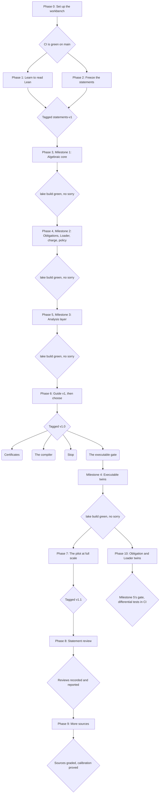

# Project roadmap

Eleven phases, each ending at a gate you can check yourself. You move on when a gate passes, not when a date arrives, and Phase 6 includes permission to stop.

## At a glance



*project roadmap · 11 phases and Milestone 4, 11 gates, 4 closing options*

Each diamond is a gate: the checklist at the end of that phase's section. Phase 1 feeds the same gate as Phase 2, because reviewing statements takes both. At v1.0 you chose the executable gate, and Phases 7–10 carry it to real claims.

## Ground rules

You own the statements, Claude Code owns the proofs, and the kernel gives the verdict. Five stop rules keep the scope from creeping.

**You own the statements.** Lean checks that a proof is valid. It cannot check that a statement means what you intended, and the [Lean reference](https://lean-lang.org/doc/reference/latest/ValidatingProofs/) draws exactly that line. The [Thomson N=7 repo](https://github.com/huwngtran/thomson-n7-lean) is candid about it: its description says the statement is not human-certified. Reviewing statements is the one job nobody can do for you.

**Claude Code owns the proofs.** It writes, repairs and refactors proof code. It never edits the statements file.

**The kernel gives the verdict.** Nothing counts as proved until CI passes: the build is green, there is no `sorry`, the axioms are only `propext`, `Classical.choice` and `Quot.sound`, and Comparator confirms the proof proves exactly its frozen statement.

**Every theorem needs teeth.** A theorem earns its place only if a plausible wrong implementation would fail it. Each theorem names such a mutant, and `JSG/Tests/Mutants.lean` proves that the mutant violates the statement. If even a gate that rejects everything would pass a theorem, the theorem says nothing about this gate. A mutant shows that a statement can fail, not that it catches the mistakes you will actually make, so take mutants from real defects in the corpus where you can: the v1 fold, the subadditive debit, the inverted No-Zeno inequality, the drafts' dropped must-fails.

The stop rules:

1. **Gates, not dates.** Advance when a phase's gate passes. With no deadlines, there is nothing to fall behind on.
2. **Parking lot.** New ideas go into `guide/IDEAS.md`, never into the current milestone.
3. **Three strikes.** If a theorem resists three sessions, mark it Open in the layer map with one line on why, and move on.
4. **The archive is read-only.** The original papers are never rewritten; new text goes into the guide.
5. **Main always builds.** A red build on `main` gets fixed before any new work. This is what stops errors from compounding.

## Phase 0: Set up the workbench

The goal is a repo whose CI builds one trivial theorem, with every original file committed untouched.

**You:** install Lean and VS Code from the [official quickstart](https://docs.lean-lang.org/lean4/doc/quickstart.html), then confirm that the Mathlib cache downloads (`lake exe cache get`). Create the GitHub repo.

**Claude Code:** scaffold the layout below. Add CI with [lean-action](https://github.com/leanprover/lean-action), switching on `leanchecker: true`. Put this doc, exported to markdown, into `guide/`.

```
jsg-sirus/
├── archive/                 # original .tex/.md/.pdf files, never edited
├── guide/                   # MASTER_GUIDE.md, ROADMAP.md, IDEAS.md, CHANGELOG.md
├── lean/
│   ├── lakefile.toml
│   ├── lean-toolchain
│   ├── JSG/Defs.lean        # frozen: the definitions the statements use
│   ├── JSG/Statements.lean  # frozen challenge: theorem statements, as sorry
│   ├── JSG/Proofs/          # one file per milestone, restating frozen theorems
│   ├── JSG/Solution.lean    # imports every proof file; Comparator's solution
│   └── JSG/Tests/           # sanity examples, negative controls, Comparator self-test
├── scripts/check.sh         # build, axiom audit, statements-unchanged check
├── scripts/comparator.sh    # each proof against its frozen statement
├── CLAUDE.md
└── .github/workflows/ci.yml
```

The layout borrows from the Thomson repo, which keeps its fixed challenge file and its solution as separate Lake libraries and checks the challenge's hash in a script.

**Line endings, before the first commit.** On Windows, Git converts line endings by default. That would quietly change the "untouched" archive files, and it would make `Statements.lean` hash differently on your PC than in CI, which runs on Linux. Commit this `.gitattributes` first:

```
* text=auto eol=lf
archive/** -text
```

Two companions keep it airtight. Set your editor to save with LF (in VS Code, `"files.eol": "\n"`), so files don't change before Git sees them. And have the statements check compare what Git stores rather than the bytes on disk, for example `git diff --exit-code statements-v1 -- lean/JSG/Statements.lean` once the tag exists. If anything was committed before this file, run `git add --renormalize .` once.

**Gate**

- [x] `.gitattributes` is in the first commit, before any other file
- [x] CI is green on `main` with one trivial theorem
- [x] `archive/` holds every original file, committed once
- [x] `CLAUDE.md` is in place (starter below)

## Phase 1: Learn to read Lean

The goal is to read a theorem statement and a short proof and explain each line. You are training to review statements, not to become a Lean expert. This phase runs alongside Phase 2.

1. Start with the Natural Number Game, listed on the community's [learning resources](https://leanprover-community.github.io/learn.html) page, for tactic basics.
2. Work through [Mathematics in Lean](https://leanprover-community.github.io/mathematics_in_lean/) chapters 2–4 (basics, logic, sets and functions) and chapter 7 (structures). That covers Milestone 1. Chapters 11–13 (topology, calculus, measure theory) wait until Milestone 3.
3. Get comfortable with the two Mathlib types the revised core is built on: `ENNReal`, the extended non-negative reals, whose subtraction truncates at zero; and complete lattices, with `⊓` and `sInf`.
4. Use [Loogle](https://loogle.lean-lang.org/) to search Mathlib by name or type shape. Most of Milestone 1 is finding the right existing lemma.
5. Have Claude explain proofs line by line, but write the two easiest ones yourself: `combine_comm` and `expiry_tightens`.

**Gate**

- [x] You proved `combine_comm` without Claude writing it
- [x] You can explain every line of the Milestone 1 block of `Statements.lean` in plain English

## Phase 2: Freeze the statements

The goal is `Statements.lean` v1: the fixed target every later proof is judged against, like the Thomson challenge file.

**You:**

1. Adopt core v2 and the v2 Lean stubs from the master guide. The rails decision is made (`guide/decisions/RAILS.md`): the rails are declared Norm-layer values that no v1 gate enforces, and persistent weakenings wait for the milestone that states the token bucket.
2. Review each definition and theorem. Fix anything that doesn't say what you mean, and give every theorem a plain-English docstring.
3. Write the controls in `JSG/Tests/`: must-pass inputs the gate must ACCEPT, must-fail inputs it must REJECT, and, for each theorem, one mutant where it fails and one witness instance where it holds. The compiler checks only that names exist, so these are what catch a statement with a real name used the wrong way round, such as swapped arguments to a relation. For instance, the always-REJECT gate is the mutant for `verdict_complete`.

**Claude Code:** make the stubs compile with `sorry`, and prove each mutant's counterexample and each witness instance in `JSG/Tests/Mutants.lean`. Two checks already run in CI: the statements check (a diff against the tag over every file the statements depend on) and Comparator.

**Gate**

- [x] `Defs.lean` and `Statements.lean` compile, with `sorry` as the only gap; every definition the statements use is in `Defs.lean`, so the proofs import the same definitions
- [x] Every theorem has a docstring you wrote or approved
- [x] Every theorem's mutant counterexample and witness instance are proved, before any milestone proof starts; a counterexample that comes too easily is a warning that the statement may be false for everything
- [x] The file is tagged `statements-v1`, and any later change needs a `CHANGELOG.md` line saying whether it tightens or weakens

## Phases 3–5: The three proof milestones

Each milestone proves one block of `Statements.lean` and closes at the same gate. Milestone 1 already holds a real catch: proving `fold_check_vacuous` shows the governance check can never fail.

| Milestone | Theorems | Read first | Expected difficulty |
| --- | --- | --- | --- |
| 1: Algebraic core | `combine_comm`, `combine_assoc`, `interchange`, `verdict_sound`, `verdict_complete`, `residual_spec`, `no_flip`, `fold_check_vacuous` | Mathematics in Lean ch. 2–4, 7; the `ENNReal` API | Low: case splits on axis kind, plus finding the right `ENNReal` lemmas |
| 2: Obligations, Loader, charge, policy | Typed obligations and leases (`pass_sound`, `pass_complete`, `lease_sound`, `lease_complete`), `Loader.safe`, `Loader.terminates`, the concrete Loader (`LoaderStep.inv_step`, `LoaderStep.progress`), `threads_spec`, `charge_append`, `charge_chatter`, `expiry_tightens`, `bridge`, `mfGate_signed` | Mathematics in Lean ch. 5–6 | Low to medium: Dershowitz–Manna and lattice lemmas take some finding |
| 3: Analysis layer | CVaR tail to level (`cvar_tail_to_level`), `dwell_lower_bound`, the local KL–Fisher bound (`kl_fisher_local`), the DRO envelope identity (`dro_envelope`) | Mathematics in Lean ch. 11–13 | Medium to high: the statements need as much care as the proofs |

**Milestone 1 notes**, for right after the `statements-v1` tag:

- **`no_flip` is in Milestone 1.** It's proved in place in `Statements.lean`, but Comparator counts it only once a proof file restates it.
- Done in #24: two mutants taken from real defects, in `JSG/Tests/Mutants.lean` beside the current ones. Both are new controls, not statement changes.
  - **`interchange`: SCp2's operator pair.** It uses ⋆ (+) in sequence and ⊎ (max) in parallel, which SirusSC implements as `Q.sequential` and `Q.hetero_join`. On a floor axis with a = 1, b = 0, c = 0, d = 1, parallel-of-sequences grades max(1 + 0, 0 + 1) = 1, but sequence-of-parallels grades max(1, 0) + max(0, 1) = 2.
  - **`charge_chatter`: SCp2's max-fold debit (§5).** It doesn't double-charge repeats, so [v, −v] costs A‖v‖, not 2A‖v‖. `charge_chatter` is a Milestone 2 theorem, but its mutant goes in now with the other.

**Milestone 2 notes**, for the milestone's closing note:

- `Loader.safe` and `Loader.terminates` hold for any Loader. `statements-v2` states a concrete one: `LoaderStep`, whose invariant `LoaderInv` is L1–L10, and which starts from `bootState` and runs each stage once, on its ticket. Once `LoaderStep.inv_step` and `LoaderStep.progress` are proved, it can be built as a `Loader`, and the two theorems apply to it. Milestone 2's note must say whether that has happened, and that the Loader is generic in its cryptographic primitives (QUEUE.md, Q7). Done: it was built in #48, and the closing note in `MILESTONE_2.md` says both.
- The archive's one implemented Loader, SirusSC's `specchain/loader/loader.py`, doesn't supply it as written. It runs ten baseline checks numbered I1–I10, but only I1, the raw-data digest, is SCp3's I1 (our L1); the other nine are different checks under the same numbers. Its termination is a dwell countdown, with "strict decrease" set by which guard ran (`strict = guard.__name__ in ("guard_CBF", "guard_OMEGA")`), and its rank vector (`rank = [0, 0, 0, 0, 0]`) is never updated.

Of Milestone 3's statements, `dwell_lower_bound` is frozen in `statements-v1`, and `statements-v3` froze the other three (#50) before any proof work on them started.

**Milestone 3 notes**, for the milestone's closing note:

- `dro_envelope` is about the dual value. That the dual equals the worst-case risk is strong duality, which isn't stated (QUEUE.md, Q10), so the note shouldn't claim the identity for the risk itself. Done: the closing note in `MILESTONE_3.md` claims it for the dual value only.
- `kl_fisher_local` is in whitened coordinates (QUEUE.md, Q9). Its proof's four helper lemmas belong in `Lemmas/`: the KL divergence of a tilted measure, the one-dimensional bound along the ray, and two pieces of algebra. Done: they're in `Lemmas/KLFisher.lean` (#54).

**Gate for every milestone**

- [ ] `lake build` is green, with no `sorry` in the milestone's proof file
- [ ] `#print axioms` on each theorem lists only `propext`, `Classical.choice` and `Quot.sound`
- [ ] The statements check confirms that every file the statements depend on is unchanged: `Defs.lean`, `Statements.lean`, their project imports, the toolchain, the Mathlib pin and the lakefile
- [ ] Comparator confirms that each theorem in `JSG/Proofs/` proves exactly its frozen statement with only the permitted axioms, and lists none of the milestone's theorems as not yet proved
- [ ] Each theorem's named mutant is proved to violate it, and every must-pass control is accepted
- [ ] Layer-map rows are set to Proved, and the guide's text names the Lean theorem
- [ ] A short note, in your words: what is now proved, and what it does not show

## Phase 6: Guide v1, then choose

The goal is a tagged release that a stranger could clone and check. After it, you pick at most one next direction, or none.

**Gate**

- [ ] `README.md` and `REPRODUCE.md` explain how to build and check everything
- [ ] Every layer-map row has a status and points to its Lean theorem or its reason for being out of scope
- [ ] One full-strength Comparator run, the gold-standard check the [Lean reference](https://lean-lang.org/doc/reference/latest/ValidatingProofs/) describes: the nanoda kernel enabled and the full sandbox (landrun with the `systemd-run` wrapper from Comparator's README). CI's best-effort run, without nanoda or the wrapper, is the everyday check, not this one
- [ ] Tagged `v1.0`

**Then pick one:**

- **Certificates.** Check PR/GKYP witnesses as exact rationals in Lean. The Thomson proof does this for semidefinite certificates: a numerical solver finds them, they are rounded to exact numbers, and Lean checks those numbers.
- **The compiler.** State the Launchpad's adequacy theorem precisely, then freeze it in a statements version of its own.
- **The executable gate.** Run the core's definitions as executable twins, each proved to agree with its frozen definition, and pilot the gate on the openai/math release ([EXECUTABLE_GATE.md](EXECUTABLE_GATE.md)). `statements-v4` starts it; see the next section.
- **Stop.** A tagged v1 with a proved core is a finished project.

## After v1.0: the executable gate

`statements-v4` starts the executable gate ([EXECUTABLE_GATE.md](EXECUTABLE_GATE.md)). Milestone 4 proves its theorems and closes at the same gate as Milestones 1–3. The harness, the differential tests and the pilot follow (EXECUTABLE_GATE.md §5).

| Milestone | Theorems | Read first | Expected difficulty |
| --- | --- | --- | --- |
| 4: Executable twins | `xknown_agrees`, `xunknown_agrees`, `xcombine_agrees`, `xverdict_agrees`, `xresidual_agrees`, `xthreads_agrees`, `xwidth_agrees`, `xleaseVerdict_agrees` | Mathlib's `WithTop` and `NNRat` API; Milestone 1's proofs, which these mirror | Low: each reduces to a lemma about the cast `xcast`, and the draft's provability check proved all eight in about 50 lines |

**Milestone 4 notes**, for the milestone's closing note:

- The twins cover finitely many axes (`Fintype`), and only the definitions Q11 chose. The obligation and Loader twins, and with them `pass_sound` for what the harness computes, wait for a later version. Done: the closing note in `MILESTONE_4.md` says both.
- The cast lemmas belong in `Lemmas/`, as Milestone 3's helpers went in `Lemmas/KLFisher.lean`. One of them, truncated subtraction under the cast from ℚ≥0 to ℝ≥0, isn't in Mathlib. Done: all eight are in `Lemmas/Twins.lean` (#64–#67), that one as `nnrat_cast_tsub`.
- The full-strength Comparator run takes every frozen theorem as a target. Once `statements-v4` is tagged, it fails until Milestone 4 is proved, and the everyday run lists the eight as not yet proved. Done: after #70, both pass on `main` with all 34.
- README and REPRODUCE describe v1.0, with a note on what v4 adds and what is pending. The closing PR updates their status, and records a full-strength run on `main`. Done: in #71, with run 40840546350.

## After Milestone 4: grading real claims

Four phases take the executable gate to real claims. Their goal is a gate that grades a claim and says exactly what evidence is missing. The pilot's report on openai/math already has that shape: none of its 724 manuscripts is accepted, and each report names the axes that hold it back (`pilot/reports/catalogue.md`). Each phase fills in evidence that's missing, and ends at a gate like the earlier ones.

Phases 7–9 run in order, since each needs the one before: Phase 8 reviews the challenges Phase 7 checks, and Phase 9's new sources need both. Phase 10 depends only on Milestone 4, so it can run beside them when review time allows. Both it and Phase 8 ask for your review, so they're better run one after the other.

### What the phases draw on

Three resources limit the work, and the scarcest is your review time.

- **GitHub Actions, as measured** (#83, [EXECUTABLE_GATE.md](EXECUTABLE_GATE.md) §4). A hosted runner has 4 cores, 16 GB of memory and a 6-hour job limit. It has 104 GB of free disk once the workflow removes preinstalled tools. LibSpec is public, so its minutes cost nothing, and GitHub's free plan runs up to 20 jobs at once. Four challenges took 2 h 29 min and 22.7 GB, and Catalan alone took 85 minutes, 41 of them in the kernels.
- **BLT, now Ubuntu 20.04, for trusted builds and data work only.** Its 144 cores and 1,500 GB of memory suit LibSpec's own builds, the collectors and calibration data. Ubuntu 20.04's glibc 2.31 runs Lean, which needs 2.26 or later. Some things need checking with BLT's admins:
  - **Its documentation is out of date.** It still says CentOS 7.4, and gives each user 25 GB, which may still hold.
  - **Landlock, which Comparator's sandbox needs, can't be checked from outside.** Ubuntu 20.04's original kernel, 5.4, predates it: Landlock arrived in Linux 5.13. Its hardware-enablement kernel, 5.15, builds Landlock in, but Ubuntu's change that enables it at boot went into 22.04's kernel, and there's no sign it reached 20.04's. Three commands on BLT settle it: `uname -r`; `cat /sys/kernel/security/lsm`, which lists `landlock` if it's on; and `dmesg | grep landlock`.
  - **Even with Landlock,** BLT shouldn't run the release's code, as §4 explains, so Comparator stays on Actions.
  - **Ubuntu 20.04 left standard support in May 2025.** That's a reason to keep BLT to trusted work.
- **Your review time.** Each phase lists what it asks of you, and keeps that to decisions, reviews and the merges CLAUDE.md reserves for you. Claude Code decides and logs the rest. The queue holds at most three open questions, so a phase never waits on more than three of your answers.

## Phase 7: The openai/math pilot at full scale

The goal is a trusted Comparator result for every challenge in the release, folded into the report, and a tagged `v1.1`.

**Done already:** the collectors and the report cover all 724 manuscripts (#85), and the release's import graph is read (#86, `pilot/data/shards.json`). It reproduces #83's measurements exactly: each challenge's closure is the set of the release's modules its build compiled. The challenges need 113,748 of the release's 163,096 modules, and families barely share them.

**Steps:**

1. **Plan the shards from the import graph:** one per family, as you decided. That's 244 shards. 181 of them take under half an hour by every estimate. So a job runs one large family, or several small ones in turn, and each family's results stay its own. That keeps each job's setup, a few minutes to fetch the release and its dependencies, from dominating.
2. **Build the two-job workflow.** For each shard:
   - **An untrusted job** runs `lake update`, which applies the release's patches to its dependencies, and uploads their sources.
   - **A fresh trusted job** never runs the release's lakefile outside the sandbox. It fetches the challenge and solution files itself, at the pinned commit. It checks the untrusted job's output against the pin: each dependency at its manifest revision, with exactly the release's patches applied. It fetches Mathlib's cache with our own tooling. Then it runs Comparator with nanoda and the full sandbox, capped at 5 hours a challenge.
3. **Show that the trust boundary bites,** as #73 and #80 did for other checks. A throwaway branch's untrusted job tampers with each of these in turn, and the trusted job must refuse each:
   - a challenge file;
   - a dependency, outside its patch;
   - the tools cache.
4. **Run every shard.** Record the results in `pilot/data/comparator-results.json` as trusted, and classify each failure as a rejection, a build error or a timeout, with its log.
5. **Regenerate the report and its proofs.** An accepted challenge makes `formal_proof` known, and a rejection is evidence that fails.
6. **Release v1.1.** README and REPRODUCE describe the pilot and how to rerun it, and you tag `v1.1`.

**Resources:**
- **Actions:** 47 to 128 hours of building for all 244 shards, by the two measured rates, plus the kernels and each job's setup, up to 20 jobs at once.
- **BLT:** none.
- **Your time:** merging the workflow, which changes `.github/` and `scripts/`; answering the failure question below; tagging.

**Risks:**
- **A family too big for one job.** By one estimate or the other, 5 families may take more than 5 hours: 189, 266, 090, 159, 013. Families 189, 159 have a single challenge each, so they can't be split, and a challenge longer than 6 hours can't run in one job at all. So those families are measured first. If one doesn't fit, there are two ways out: a larger runner, which costs money, or a build carried across jobs, which needs its own trust argument. A family that doesn't fit in 6 hours and 104 GB is split by challenge, and modules its challenges share then build more than once.
- **The estimate covers building only.** The kernels can take as long, as on Catalan, and the import graph doesn't predict them.
- **Dependencies aren't in the estimate.** PrimeNumberTheoremAnd, Carleson and the release's other 28 packages build from source too. Their sources come only from the untrusted job, so the trusted job is the first to see how big they are.
- **Checking the untrusted job's output is the weak point.** If the check misses a change, a tampered dependency could change what a challenge proves. The negative controls in step 3 are what show it doesn't.
- **The release moves.** openai/math keeps changing, and the pilot stays pinned at `7ef5c0c`. So v1.1 grades that commit, not the release as it later stands.
- **Build errors and timeouts aren't rejections.** They leave `formal_proof` unknown. That keeps the report honest, at the price of axes that stay unknown.

**Decisions that stay yours:**
- merging the workflow and its scripts;
- whether a build error or a timeout is ever evidence that fails, since that changes what a report says, so it goes in the queue;
- what to do with a challenge that can't finish in 6 hours: a larger runner, or a build carried across jobs;
- whether to move the pin to a later commit;
- tagging `v1.1`.

**Gate**

- [ ] The negative controls show that the trusted job refuses each tampered input
- [ ] Every challenge has a trusted result, or a classified failure with its log
- [ ] `pilot/reports/catalogue.md` is regenerated with them, and its proofs pass
- [ ] README and REPRODUCE describe the pilot and how to rerun it
- [ ] Tagged `v1.1`

## Phase 8: Statement review

The goal is a protocol that a named reviewer follows to check that a challenge states its paper's claim, and a simple page that records what they find. That makes `statement_fidelity` known.

Comparator checks a proof against its challenge's statement, but not that the statement says what the paper claims. The release's `formalization.yaml` records its review as `unchecked`. Anthropic's ETH formalization says it too: "no machine checks that this file says what the paper says."

**Steps:**

1. **Write the protocol,** `guide/REVIEW_PROTOCOL.md`.
   - **What to read:** the paper's top-line claim, the challenge file, and every definition the challenge uses that isn't Mathlib's.
   - **What to check:** quantifiers, hypotheses, edge cases, and any definition that would make the statement trivial.
   - **What to record:** the reviewer's name, the date, the challenge and commit, and a verdict: it states the claim, it states a weaker or a different claim, or the reviewer can't tell. Each verdict comes with a sentence saying why.
2. **Extend the raw record.** `Raw.fidelityBy` holds only a reviewer's name, so today a review can only show that a statement is faithful. A review that finds a mismatch must count as evidence that fails. So `Raw` gains the verdict, and its sentence goes into the report. That changes the pilot's own module, which isn't frozen.
3. **Build the review page.** It lists the challenges awaiting review, and shows the paper's claim, the challenge's statement and its definitions side by side. Then it records a verdict, and a collector reads the verdicts into `pilot/data/`. There are two ways to host it:
   - **an Artifact page with a shared database,** which Claude Code can build and you can share;
   - **a GitHub issue form,** which keeps every review in the repository's history.
4. **Pilot the protocol on six challenges:** the four Comparator accepted in #83, and the ETH and local-smoothing challenges, `SubexponentialSAT` and `LocalSmoothing`. Record how long each review takes.
5. **Calibrate it** with a synthetic challenge whose statement is subtly weaker than its paper's claim. Its review must not count as faithful.

**Resources:**
- **Reviewers' time, above all.** Yours too, if you review. The six reviews in step 4 measure the cost before any more are asked for.
- **Actions** for the collector.
- **BLT:** none.

**Risks:**
- **Deep results take long to review.** The pilot measures how long, and the protocol may need a lighter first pass.
- **A verdict is a human judgement.** Two reviewers can disagree, and that needs a rule.
- **A challenge's own definitions can hide what it claims.** The protocol has to make the reviewer read them, not just the theorem.
- **Names on a page.** Recording a reviewer's name needs their consent, and the page needs access control, so a review can't be edited by someone else.
- **No manuscript is accepted after this phase alone.** `independent_review` and `novelty` stay unknown until a source supplies them (Phase 9).

**Decisions that stay yours:**
- who counts as a named reviewer, and how a disagreement between reviewers is settled;
- the protocol itself;
- where reviews live: the page or issues;
- whether reviewers' names are published.

**Gate**

- [ ] The protocol is approved and in the guide
- [ ] The page records a review, and the collector reads it into the report
- [ ] Six challenges are reviewed under the protocol, with the time each took
- [ ] The synthetic weaker statement is not counted as faithful, and its reason shows in the report

## Phase 9: More sources

The goal is to grade claims beyond openai/math, and to calibrate the gate on claims whose fate is already known.

**Claims to grade:**
- **OpenAI's October claims.**
  - Two are in the release already pinned: "The Exponential Time Hypothesis is False" (family 378, challenge `SubexponentialSAT`) and "Local smoothing for the Euclidean wave equation" (family 079, `LocalSmoothing`). Phase 7 checks their formalizations. Phase 9 adds evidence from outside the repository, such as the independent review that Russell Impagliazzo, Ramamohan Paturi and Ryan Williams are organizing for the ETH claim.
  - The Yang–Mills claim has no released proof. Its record holds only the announcement, so every axis stays unknown, and its report says so.
- **Anthropic's 3-SAT paper,** "A 2^o(n) Time Algorithm for 3-SAT", in `anthropics/formal-math` under `eth/`, Apache-2.0. Its Lean formalization comes with a challenge file and a Comparator config. It pins Lean `v4.33.1`, not our `v4.34.1`, so Comparator's tools must be built for that toolchain too.
- **Astra's ten,** OpenAI's results of August 2026: a manuscript and a repository of Lean proofs. Their layout and license need checking first.

**Calibration sources,** whose papers are known to be withdrawn or retracted:
- **arXiv withdrawals.** A withdrawn paper stays listed, with its metadata, and arXiv serves metadata over OAI-PMH. How a withdrawal shows in that metadata needs checking first.
- **Crossref's Retraction Watch data.** It has been open since 2023: as a CSV updated every working day, at `gitlab.com/crossref/retraction-watch-data`, and in the update metadata of Crossref's REST API.

A sample of withdrawn or retracted mathematics papers then becomes a must-fail set at scale. Each must be not accepted on known axes alone, proved by the kernel, which tests the collectors' detection as much as the gate. A must-pass set from outside is harder. It needs results with a complete formalization, a checked statement and a published review, and choosing them is yours.

**Steps,** for each source:
1. Check its license and pin a commit or a snapshot.
2. Write a collector that reads it as data only.
3. Map its facts to `Raw`, extending `Raw` when a source brings a new kind of fact, such as a retraction notice.
4. Write its report and its proofs.
5. Check its challenges on Phase 7's trusted shards.

**Resources:**
- **BLT, for the data work.** The Retraction Watch CSV and arXiv's metadata are small enough for a 25 GB quota.
- **Actions,** for Comparator on each new source's Lean.
- **Your time:** choosing sources, and answering what counts as a withdrawal.

**Risks:**
- **Terms of use.** arXiv's metadata and the Retraction Watch data each have terms, which must allow what we store.
- **Matching records.** A retraction notice has to be matched to the paper, and the paper to the claim. A wrong match would make a must-fail test fail for the wrong reason.
- **Sources move.** The ETH review will finish after any pin, so each source's records name their date and commit.
- **Toolchains differ.** Each Lean version needs its own build of Comparator's tools.
- **Reports about other organizations' claims are public statements.** Their wording stays "not accepted: evidence incomplete on …", and publishing them is your call.

**Decisions that stay yours:**
- which sources to add, and in what order;
- what counts as a withdrawal: a retraction, an expression of concern or a correction. That changes what the `withdrawn` axis means, so it goes in the queue;
- whether to publish any report on another organization's claims;
- a real must-pass set.

**Gate**

- [ ] Each new source has a pinned record set, a license note and a report
- [ ] Every withdrawn or retracted paper in the calibration sample is not accepted on known axes alone, proved by the kernel
- [ ] Every new source's challenges have a trusted Comparator result, or a classified failure

## Phase 10: The obligation and Loader twins

The goal is executable twins of typed obligations and of the concrete Loader, each proved to agree with its frozen definition, once SirusSC's loader is under test. Q11 deferred them until there was an implementation to test them against.

**Steps:**

1. **Put SirusSC's loader under test,** as #78 did for its algebra. An adapter runs `specchain/loader/loader.py` in place from `archive/`, against a corpus of Loader runs, with a model of its known defects:
   - with fewer inputs than guards, it skips the rest silently (IDEAS.md);
   - its I1–I10 are different checks from SCp3's, under the same numbers;
   - its rank vector is never updated.
2. **Draft `statements-v5`:** twins of the obligation layer and of `LoaderStep`, their agreement theorems, a mutant and a witness for each, and a provability check, in a draft PR as for v2–v4. The concrete Loader is generic in its cryptographic primitives (Q7), so its twin needs stand-ins for them.
3. **Milestone 5** proves them, at the milestone gate.
4. **Test SirusSC's loader against the twins.** It must disagree exactly where its defects predict, with every new mutant as a negative control.

**Resources:**
- **Actions,** and not much of them.
- **Your review of `statements-v5`,** the largest review these phases ask for after Phase 8's.

**Risks:**
- **SirusSC's loader is far from SCp3.** Its checks and their numbering differ, so its model may grow large.
- **A Loader run has too many states** for vectors to cover exhaustively, as #76's corpus covered the grades.
- **The twins could drift toward the code,** mirroring what SirusSC does rather than what the frozen definitions say. That's why they're proved to agree with the definitions, and only then tested against the code.

**Decisions that stay yours:**
- what `statements-v5` states, and its tag;
- whether SirusSC's loader is the implementation to test;
- any Norm-layer value a statement needs.

**Gate**

- [ ] The milestone gate, for Milestone 5
- [ ] The differential test runs in CI, with SirusSC's loader disagreeing exactly where its defects predict, and every new mutant as a negative control

## One sitting with Claude Code

One sitting, one target. The same six steps every time keep sessions small enough to review. Claude Code settles reversible choices itself and logs them in `guide/LOG.md`. Anything that changes a statement's meaning, a Norm-layer value or anything frozen, or that weakens a check, waits in `guide/QUEUE.md` (CLAUDE.md, "When to ask the human").

1. **Pick one target** from the current phase: one theorem, or one setup task. Write it as the first line of your prompt.
2. **Brief Claude Code:** the target, the files it may touch, and "stop and report when the build is green, or after three approaches fail."
3. **Read the diff when it stops,** with any new `LOG.md` entries. If a file the statements check covers appears in it, reject the change.
4. **Check the verdict:** run `scripts/check.sh` yourself, or read the CI result on the pull request.
5. **Ask for a five-line explanation** of the proof in plain English, and paste it into the milestone note.
6. **Close out:** answer open `QUEUE.md` entries ("not yet" is an answer), merge the PRs that are yours to merge, update the layer map, and move any new idea into `IDEAS.md`. Claude Code merges its own PRs once CI is green, unless they touch files CLAUDE.md reserves for you.

## CLAUDE.md starter

Paste this into the repo root in Phase 0. It turns the ground rules into standing instructions that Claude Code reads at the start of every session.

```markdown
# Working rules for this repo

## Roles
- The human owns `lean/JSG/Statements.lean`. Never edit it.
  If a statement looks wrong or unprovable, stop and explain why.
- Proofs go in `lean/JSG/Proofs/`, helper lemmas in `lean/JSG/Lemmas/`.
- `archive/` is read-only.

## Definition of done
- `lake build` passes with no errors, and no warnings in files you touched.
- No `sorry`, `admit`, `axiom`, or native evaluation (`native_decide`, `decide +native`).
- `#print axioms` on each target shows only propext, Classical.choice, Quot.sound.
- Every theorem has a named mutant, and `JSG/Tests/Mutants.lean` proves the mutant violates it.
  Prefer mutants taken from real defects in archive/ over invented ones.
- Every theorem also has a witness instance in `JSG/Tests/` where it holds.
- `scripts/check.sh` passes.

## How to work
- One target per session unless told otherwise.
- Search Mathlib (Loogle, exact?, apply?) before writing a helper lemma.
- Treat any Mathlib name recalled from memory, yours or another model's, as a guess until Loogle confirms it.
- Never weaken a hypothesis or change a statement to make a proof go through.
- After three failed approaches, stop. Report what you tried, what blocked you,
  and whether the statement itself might be false.
- End every session with: files changed, theorems closed, ideas added to guide/IDEAS.md.
```

The ban on native evaluation matters because the independent checkers in the gold-standard check cannot replay native computation.

## Sources

Pages checked Sep 29, 2026. When you get stuck, the [Lean Zulip](https://leanprover.zulipchat.com/) is where the community answers questions.

- [Thomson N=7 Lean proof package](https://github.com/huwngtran/thomson-n7-lean): a worked model of a statements-first repo, with a fixed challenge file, a check script and a claims index
- [Validating a Lean Proof](https://lean-lang.org/doc/reference/latest/ValidatingProofs/): the escalating checks, from axioms to leanchecker to Comparator
- [lean-action](https://github.com/leanprover/lean-action): the GitHub Action for CI, with `leanchecker` and `nanoda` switches
- [Comparator](https://github.com/leanprover/comparator): judges a proof against a fixed statement file
- [Mathematics in Lean](https://leanprover-community.github.io/mathematics_in_lean/): the textbook for Phase 1 and the milestones
- [Options to use Lean](https://leanprover-community.github.io/get_started.html): install, learning resources, Loogle and Zulip links
