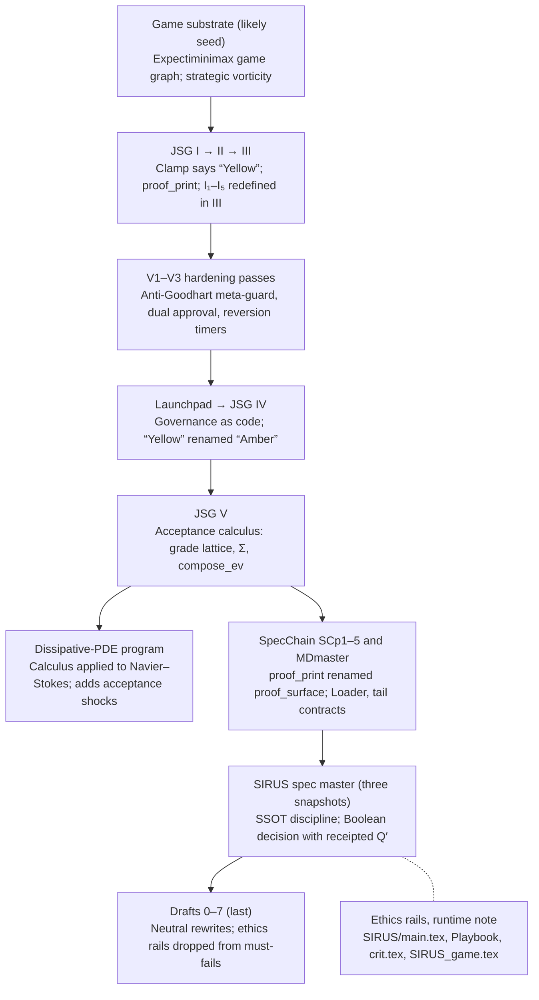

# Sources

Where the canon came from, and what each source in `archive/` is canonical for.

## Corpus lineage

The JSG books came first and the neutral drafts last. The order is inferred from renamed terms, because the dates embedded in the files are partly example values.

*corpus lineage · 8 stages, 2 side branches*

Solid arrows mean a stage builds on the one before it; the dashed line marks work from the same period. The PDE program branches off the JSG V calculus.

## Source map

Seven sources stay canonical, four merge into the guide, three split, and the rest are archived. Rows follow the lineage order.

| Source | Canonical for | Action | Note |
| --- | --- | --- | --- |
| JSG I | Hybrid calculus, No-Zeno, alignment primitives | Keep | Fix the No-Zeno lemma first |
| JSG II | Runtime guards, MTC and IV badges, decision range, lever dictionary | Merge | Into the operations chapter |
| JSG III | Guard order, failure cookbook, lever ABI, curvature-per-collateral | Merge | Canonical for guard order |
| Solanum | LaTeX sources of JSG I–III, split by section, with build and merge tooling, registries and docs; `high_res.py`, a higher-resolution revision of `fluid_sim.py` | Archive | 92–98% of its JSG I–III lines are already in `Buckshot_Roulette/JSGI–III.tex`. Its `jsg/.gitattributes` is left out: inside this repo it would move the PDFs to Git LFS and rewrite CRLF line endings |
| Reach | jsg-lab, a Python lab for JSG I–III: frontier crossing and dwell monitors, PR/KYP checks, DRO radius, ISS budget, governance triggers | Archive | Code only. `pr_checks.py` counts a frequency grid or an inaccurate solve as certifying positive realness. Its README still describes the left-out `apps/` and `tools/` |
| V1–V3 | Anti-Goodhart meta-guard, dual approval, out-of-band monitors, VCs | Merge | Merge the deltas, then archive the files |
| JSG IV Launchpad | Framing claim and the adequacy theorem statement | Keep | Becomes the guide's introduction |
| JSG IV | ACT compiler R1–R9, governance as code, emergency VCs | Keep | Canonical governance; fix the fold |
| JSG V | Acceptance calculus: G, Σ, compose\_ev | Keep | Canonical algebra |
| DissipativePDEs | Frontier subadditivity, CVaR bridge, acceptance shocks, Navier–Stokes spine | Split | Calculus parts into JSG V; Navier–Stokes into a research notebook |
| MDmaster | SpecChain SCp1–5 (Loader, tail contracts), game substrate, forward/inverse duality | Split | Keep SpecChain and the game sections; remove the SIRUS-algorithm sections |
| SirusSC | SpecChain SCp1–5 in full (`papers/`); `specchain`, a Python reference scaffold (Q, Q′, Δ\_fr, Loader, tail contracts, receipts); an implementation conformance analysis | Split | Keep the papers: they are the full text that MDmaster's SCp sections summarize, and the two differ in places. Archive the code, which never checks a budget, and the analysis, which describes an earlier version of the code |
| SIRUS\_SPEC\_MASTER | SSOT discipline, decision layer D and R, GMM, SSG, self-specification | Keep | The one canonical snapshot |
| SIRUS\_SPEC\_MASTER\_revised, Untitled.md | Near-duplicate snapshots, each about 1,300–1,450 lines different | Archive | Diff once for anything the master lacks |
| SIRUS/main.tex, Operational\_Playbook, crit.tex | Normative rails, the vow, the human-facing guide | Keep | Norm layer and onboarding. NormGovProposal/main.tex, which shares most of its text with the Playbook, is headed "Private / Classified": a self-applied draft label, not a security classification |
| Repo\_conventions, Human\_Guide | WorkCard schema, PR plan, agent orchestration loop | Merge | Contributor docs; reword the CI claim |
| SIRUS.tex | Table scaffolding for the fixed pipeline | Archive | Template only |
| SIRUS\_game.tex | A pdfLaTeX error log; the runtime note survives only in its missing-character lines | Archive | Recover the text first |
| Draft7 | Neutral external proposal | Keep | The external-facing summary |
| Draft0–6 | Earlier versions of the same proposal | Archive | Superseded by Draft7 |
